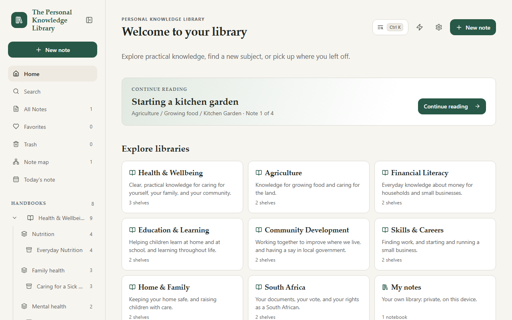
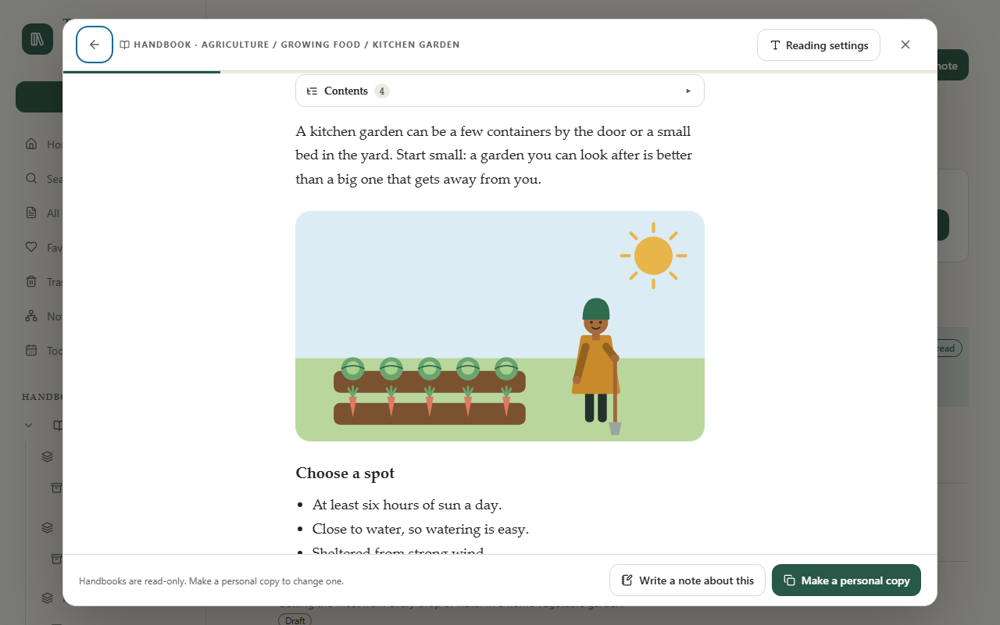

# The Personal Knowledge Library

**A calm, private library for reading and keeping knowledge, offline.**

The Personal Knowledge Library is an installable web app. It opens on a library
of practical handbooks, written for South Africa and illustrated on every page,
and keeps your own notes alongside them. Everything works offline and stays on
your device. There is no account, no cloud sync, no advertising, and no AI.



**Use it now:** <https://golden-startup-guide.github.io/get-started/>, nothing to
install or sign up for. Install it from there to use it like an app, offline.

## What you can do

- **Read the handbooks:** eight libraries (Health & Wellbeing, Agriculture,
  Financial Literacy, Education & Learning, Community Development, Skills &
  Careers, Home & Family, and South Africa) with 49 pages. Each page has a
  picture of what it explains and ends with the sources it was written from.
  They are drafts until qualified reviewers have checked them.
- **Read comfortably:** a reading room with one column at a comfortable line
  length, **Reading settings** for text size, style, spacing, and theme, and
  **Previous** and **Next** by name. Home offers to **Continue reading** where
  you left off.
- **Always know where you are:** Library → Shelf → Notebook → Note, with a
  breadcrumb on every page, and an address for every page and note, so Back,
  Forward, and bookmarks work.
- **Find and connect:** one **Search** across the handbooks and your notes.
  Each page lists what it is **Mentioned in** and its **Related notes**, and the
  **note map** shows a note's neighbourhood, with the same notes as a list.
- **Keep your own notes:** in your own libraries, with formatting buttons,
  checklists, tables, maths, diagrams, templates, daily notes, quick notes
  (Alt+N), and a command palette (Ctrl+K). Make a personal copy of any handbook
  page, or write a note about it. Notes save as you type, with restorable
  history.
- **Never lose a note:** Trash, automatic backups to a folder (proven by
  restoring each one) or backup reminders, a repair check at start-up, and
  upgrades tested against every past version.
- **Move your notes freely:** export as Markdown files, and import from
  Obsidian, Notion, Evernote, Google Keep, Apple Notes, and Markdown folders.
- **Use it anywhere:** on a phone, tablet, or computer, online or offline, in
  English, Spanish, or Arabic (right to left). It aims for WCAG 2.2 AA:
  usable with a keyboard, a screen reader, zoom, and high-contrast modes.



## Get started

Requirements: Node.js and npm for local development; a modern browser with
IndexedDB for using the app.

```bash
npm ci
npm run dev
```

Open the local URL printed by Vite. To create and serve a production build:

```bash
npm run build
npm run preview
```

The production build includes a web app manifest and a service worker that
precaches the app shell. Install the app from the browser's install control on
supported devices. Production service workers require HTTPS; localhost is
supported for development.

### Find your way around

The app opens on **Home**. The sidebar holds Home, Search, All Notes,
Favorites, Trash, the note map, and Today's note, then the **Handbooks** and
your own libraries as a tree. On wide screens it can collapse to a rail of
named icons; on tablets and phones it opens over the page from the menu
button. Every page has a breadcrumb, and **Skip to main content** comes first
for keyboard users. See the [complete app guide](docs/APP_GUIDE.md) for every
feature.

## Your data and privacy

Notes, relationships, attachments, settings, and history are stored in the
browser's IndexedDB database on the current device and browser profile. The Personal Knowledge Library
has no account and sends your notes nowhere; see the [privacy policy](PRIVACY.md).
It does not synchronize between devices: use automatic backups to a folder your
cloud drive syncs, or export and import, to move notes between them.
Data is also scoped to the app's origin: changing hostname, port, or browser
profile can make a different local database appear. Clearing browser site data
can remove locally stored content. If notes appear missing, do not clear site
data; first check that you opened the same app URL and browser profile. Export
a backup from **Settings** and keep a copy somewhere separate from the browser
profile.

Backups include note content and metadata, Trash, attachments, note links,
libraries, shelves, notebooks, settings, and history. The handbooks come with
the app, so they are not in backups. Import validates the file and
merges it without replacing existing notes. See the [complete app guide](docs/APP_GUIDE.md)
for storage, backup, migration, and feature details.

## Project documentation

- [Complete app guide](docs/APP_GUIDE.md): every feature, data handling,
  architecture, and development.
- [Writing handbooks](content/README.md): how the handbooks are written, with
  their sources and pictures, and how a review is recorded.
- [Acceptance](docs/ACCEPTANCE.md): the design checklist with its evidence, and
  guides for screen-reader checks, a usability session, and handbook review.
- [Knowledge Library plan](docs/KNOWLEDGE_LIBRARY_PLAN.md): the phases that
  turned the notes app into a library, as built, and
  [the design specification](docs/design/peoples-home-spec.md) behind them.
- [Accessibility](docs/ACCESSIBILITY.md): the WCAG 2.2 AA target, what is
  checked automatically, and the manual checks.
- [Decisions](docs/DECISIONS.md): storage, sync, editor, business model,
  platforms, and hosting, and why.
- [Product roadmap](docs/ROADMAP.md): feature status and future direction.
- [Translating](docs/TRANSLATING.md): the languages, right-to-left support,
  and how to add a language.
- [Performance](docs/PERFORMANCE.md): benchmark method, numbers against
  targets, and size budgets.
- [Architecture vision](docs/ARCHITECTURE_VISION.md): long-term technical
  direction for an AI-free platform; read before proposing architectural
  changes.
- [Library catalog](docs/LIBRARY_CATALOG.md): the subject libraries, those
  shipped and those proposed.
- [UI design direction](docs/UI_DESIGN.md) (earlier, superseded by the design
  specification) and the [code and data-safety audit](docs/AUDIT.md).
- [Privacy policy](PRIVACY.md) and [security policy](SECURITY.md).
- [Changelog](CHANGELOG.md) and [how releases are made](docs/RELEASING.md).

## Development

```bash
npm run lint   # ESLint (TypeScript and React rules)
npm test       # Vitest and React Testing Library
npm run test:e2e  # Playwright in Chromium, Firefox, and WebKit (production build)
npm run bench     # Performance benchmarks with generated libraries (see docs/PERFORMANCE.md)
npm run build  # TypeScript project checks and production PWA build
npm run size   # Size budgets for the install, handbooks, and start-up (after a build)
```

The app is built with React, TypeScript, Vite, Tailwind CSS, IndexedDB (`idb`),
and `vite-plugin-pwa`. Tests use Vitest, React Testing Library, and
`fake-indexeddb`.

## Licence

The Personal Knowledge Library is free software under the [MIT licence](LICENSE).
