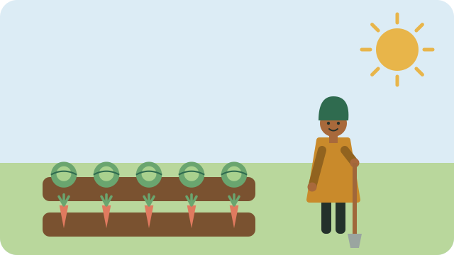

A kitchen garden can be a few containers by the door or a small bed in the yard. Start small: a garden you can look after is better than a big one that gets away from you.

## Choose a spot

- At least six hours of sun a day.
- Close to water, so watering is easy.
- Sheltered from strong wind.

## Prepare the soil

Loosen the soil and mix in compost. Good soil holds water and feeds the plants.

## Easy first crops

- Spinach and other leafy greens
- Spring onions
- Herbs such as parsley and coriander
- Tomatoes, with a stake for support

Water in the early morning or late afternoon, when less water is lost to the sun.

## Sources

- [Vegetable garden beginners' guide (Cape Contours)](https://www.capecontours.co.za/tips-to-create-your-own-vegetable-garden/)
- [Vegetable planting calendar for South Africa (My Creative Lifestyle)](https://www.mycreativelifestyle.co.za/post/vegetable-planting-calendar-for-south-africa)
