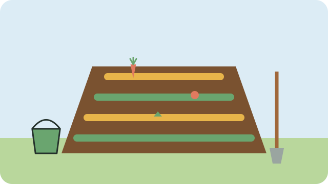

Compost is decayed plant material. Mixed into the soil, it feeds plants, helps the soil hold water, and costs nothing to make.

## What to put in

Use a mix of **green** and **brown** material:

- **Green (wet):** vegetable and fruit peels, tea leaves, coffee grounds, fresh grass cuttings, weeds without seeds, and manure from cows, goats, or chickens.
- **Brown (dry):** dry leaves, straw, dry grass, shredded cardboard, and paper without shiny print.

A good rule is about two parts brown to one part green.

## What to keep out

Meat, bones, fish, dairy, oily food, dog or cat droppings, and diseased plants. They smell, attract rats and flies, or spread disease.

## How to make a heap

1. Choose a shady spot close to the garden, on bare soil.
2. Start with a layer of twigs for air, then add brown and green layers in turn.
3. Sprinkle each layer with a little soil.
4. Keep it as damp as a squeezed-out sponge: not dry, not soaking.
5. Turn the heap with a fork every week or two, to let air in.

The compost is ready when it is dark, crumbly, and smells like earth, usually after two to four months.

## Using it

Dig compost into beds before planting, or spread a layer around plants. It also helps the soil keep water, so you need to water less; see [[Watering wisely]].

> [!TIP]
> No space for a heap? Dig a trench along a bed, fill it with kitchen scraps, cover it with soil, and plant on top a few weeks later.

## Sources

- [Vegetable garden beginners' guide (Cape Contours)](https://www.capecontours.co.za/tips-to-create-your-own-vegetable-garden/)
