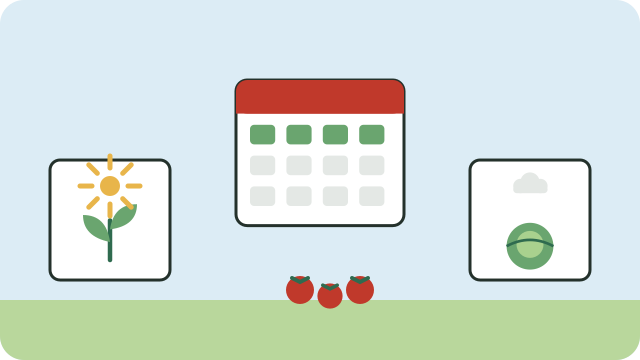

Vegetables grow best when planted in the right season. South Africa has two main rainfall patterns:

- **Summer rainfall areas**, most of the country, including Gauteng, KwaZulu-Natal, Limpopo, Mpumalanga, the Free State, North West, and the Eastern Cape.
- **Winter rainfall areas**, mainly the Western Cape.

## Summer rainfall areas

| Vegetable | When to plant | Ready in about |
|---|---|---|
| Spinach and Swiss chard | All year; best from March to August | 6 to 8 weeks |
| Cabbage | February to May, and July to September | 3 to 4 months |
| Onions | April to June | 5 to 6 months |
| Carrots and beetroot | February to May, and July to September | 2 to 3 months |
| Tomatoes | August to December, after the last frost | 2 to 3 months |
| Beans | September to January | 2 to 3 months |
| Pumpkin and butternut | September to December | 3 to 4 months |
| Maize | October to December | 3 to 4 months |

## Winter rainfall areas

The pattern is roughly reversed: plant leafy greens, cabbage, onions, carrots, and peas in autumn and winter (March to July), and tomatoes, beans, pumpkins, and maize in spring and early summer (August to December), when water is available.

## Tips

- In cold areas, wait until frost is over before planting tomatoes, beans, pumpkins, and maize.
- Plant a little every few weeks, so that you harvest a little all the time instead of everything at once.
- Ask neighbours and local farmers what grows well where you live; local knowledge is often the best guide.

See also [[Starting a kitchen garden]].

## Sources

- [Vegetable planting calendar for South Africa (My Creative Lifestyle)](https://www.mycreativelifestyle.co.za/post/vegetable-planting-calendar-for-south-africa)
- [When to plant in Johannesburg: planting calendar (Fryd)](https://fryd.app/en/garden-guide/johannesburg)
- [Planting guide for South Africa (Gardenate)](https://gardenate.com/?zone=22)
