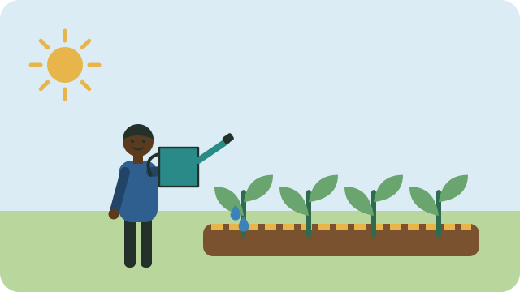

Water is precious in much of South Africa. A few habits help your garden grow well while using less of it.

## When to water

- Water in the **early morning** or **late afternoon**, when less water is lost to the sun and wind.
- Water **deeply and less often** rather than a little every day. Deep watering grows deep roots that cope better with dry spells.
- Check the soil first: push a finger in up to the second knuckle. If it is damp, wait.

## Where to water

- Water the **soil at the base of the plant**, not the leaves. Wet leaves can spread disease and waste water.
- Young seedlings need water more often than established plants.

## Keep water in the soil

- **Mulch:** cover the soil around plants with dry grass, leaves, or straw. Mulch keeps the soil cool and slows drying.
- **Compost:** soil rich in compost holds water like a sponge; see [[Making compost]].
- **Sunken beds:** in dry areas, plant in beds slightly below ground level so that water collects where roots are.

## Save and reuse water

- Catch rainwater from roofs in drums or tanks.
- Bottle drip irrigation: make small holes in the lid of a 2 litre bottle, fill it with water, and bury it upside down next to a plant so that it waters slowly.
- Grey water from washing (without strong bleach or harsh soap) can water fruit trees and flowers. Do not pour it on the leaves of vegetables you will eat raw.

> [!NOTE]
> Follow your municipality's water restrictions during droughts.

## Sources

- [Vegetable garden beginners' guide (Cape Contours)](https://www.capecontours.co.za/tips-to-create-your-own-vegetable-garden/)
- [Growing vegetables in containers: a South African quick-start guide (Pot Shack)](https://potshack.net/blogs/garden-blog/quick-guide-growing-vegetables-in-containers)
