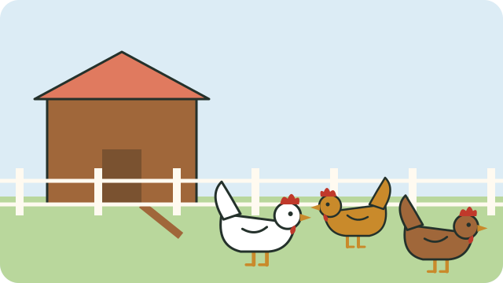

A few chickens can give a household eggs, meat, and manure for the garden. They need daily care, so start small: five to ten birds is a good beginning.

## Before you start

- **Check the rules.** Some municipalities limit how many chickens you may keep in town, and do not allow roosters. Ask at the municipal office.
- **Decide what you want:** eggs (layer hens), meat (broilers), or both (local or "village" breeds, which are hardy and good at finding food).
- **Talk to your neighbours.** Chickens can be noisy, and rats come where feed is left lying around.

## Housing

Chickens need a shelter that keeps them dry, safe, and well aired:

- A **shady, dry place on flat ground**; dig a drain around it if water collects there in the rain.
- A **roof** against rain and sun, and walls that block strong wind but let fresh air move.
- A **secure door** that you close at night against dogs, cats, snakes, and thieves.
- **Perches** for sleeping, and a few **laying boxes** with dry grass for eggs.
- Enough space: crowded chickens fight and fall ill. Allow at least a third of a square metre per bird inside, more if they cannot go outside.

## Keep it clean

- Change wet or dirty bedding often.
- Clean feeders and water containers every day.
- Use the old bedding and droppings in your compost; see [[Making compost]].

Next: [[Feeding chickens]] and [[Keeping chickens healthy]].

## Sources

- [A simple guide to managing village poultry in South Africa (Poultry Hub Australia)](https://www.poultryhub.org/all-about-poultry/village-poultry-in-south-africa/a-simple-guide-to-managing-village-poultry-in-south-africa-english-version)
- [Improving village chicken production: a manual for field workers and trainers (ACIAR)](https://www.aciar.gov.au/sites/default/files/legacy/node/11129/mn139_improving_village_chicken_production_a_manu_59315.pdf)
