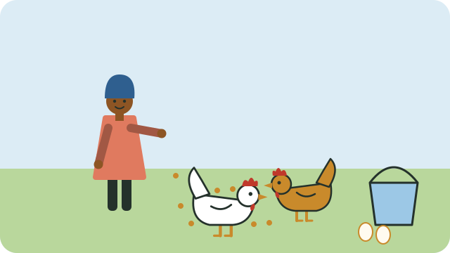

Well-fed chickens grow faster, lay more eggs, and fight off disease better.

## Water first

- A chicken drinks about **1 litre of water a day**, and more in hot weather.
- Give **fresh, clean, cool water** every day, in a container they cannot tip over or walk in.
- Without water, chickens stop laying within a day.

## Feed

- **Bought feed** is balanced for each stage: chick starter for young chicks, grower feed for young birds, and layer mash for hens that lay eggs. Follow the bag's instructions.
- **Free-ranging chickens** find insects, seeds, and greens, but usually still need extra feed, especially in winter.
- **Kitchen scraps** such as vegetable peels, leftover porridge, and greens can add to their diet. Do not feed mouldy or salty food.
- Laying hens need **calcium** for strong eggshells: crushed, dried eggshells or crushed shell grit help.

## Good habits

- Feed at the same times each day.
- Keep feed dry and covered, to stop it going mouldy and to keep rats away.
- Raise feeders to about the height of the birds' backs, so that less is scratched out and wasted.

See also [[Keeping chickens healthy]].

## Sources

- [A simple guide to managing village poultry in South Africa (Poultry Hub Australia)](https://www.poultryhub.org/all-about-poultry/village-poultry-in-south-africa/a-simple-guide-to-managing-village-poultry-in-south-africa-english-version)
- [Chicken farming in South Africa (Mzansi Farm)](https://mzansifarm.co.za/chicken-farming/)
