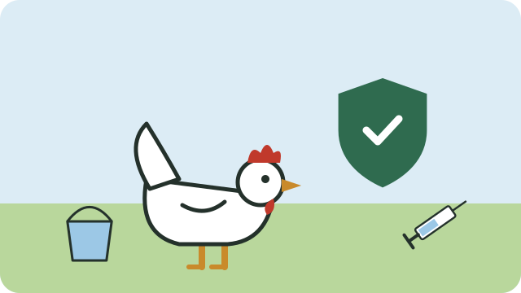

Preventing disease is much easier, and cheaper, than treating it.

## Newcastle disease

Newcastle disease is a virus that can kill most of a flock within days. It causes losses every year in townships and rural areas where chickens are not vaccinated. Signs include twisted necks, difficulty breathing, green diarrhoea, and sudden deaths.

**Vaccination protects your flock:**

- Vaccines are sold at farm co-ops and agricultural shops, and some come as eye drops, others for mixing into drinking water.
- Follow the instructions on the vaccine exactly. Vaccines in drinking water are usually given twice, two to three weeks apart, then repeated every three months or so.
- Mix the vaccine with clean water that has **no chlorine**; chlorinated tap water kills the vaccine. Rainwater or borehole water works.
- Remove water for about an hour before, so that the birds are thirsty and drink the vaccine quickly.
- Vaccinate **healthy** birds only.

## Everyday prevention

- Give clean water and good feed; see [[Feeding chickens]].
- Keep the house dry, clean, and not crowded; see [[Starting with chickens]].
- **Keep new birds apart** from your flock for two weeks before mixing them, to check that they are healthy.
- Wash your hands after handling chickens or their droppings.

## If chickens fall ill

- Separate sick birds from the healthy ones at once.
- Bury or burn birds that die; do not throw them where dogs or other birds can reach them.
- Ask an animal health technician or the state veterinarian for advice, especially if many birds die suddenly.

> [!WARNING]
> Many sudden deaths in a flock should always be reported to the local state veterinarian: some poultry diseases, including avian influenza, must be reported by law.

## Sources

- [Controlling Newcastle disease in village chickens (FAO)](https://openknowledge.fao.org/server/api/core/bitstreams/0ee168a3-53cf-4a45-a4eb-dc127373081a/content)
- [Newcastle disease in village chickens (FAO)](https://www.fao.org/4/y5162e/y5162e05.htm)
- [Vaccination tips for smallholder poultry farmers (U-Mix)](https://u-mix.co.za/poultry-vaccination-tips-smallholder-farmers/)
