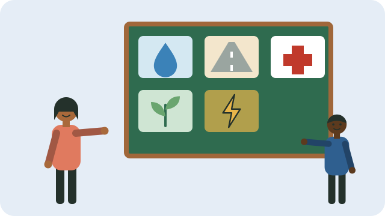

Every municipality must have an **Integrated Development Plan (IDP)**: a five-year plan for what it will build, fix, and provide, such as roads, water, sanitation, refuse removal, parks, and community halls. It is reviewed every year, and the yearly **budget** must follow it.

Residents have a right to take part in drawing up the IDP and budget.

## How to take part

- **Go to IDP meetings.** Municipalities hold public meetings in wards each year, usually several months before the new budget year starts in July. They must announce them in advance.
- **Make a written input.** Write down your community's needs and priorities, and hand them in at the meeting, at the municipal office, or by email, and keep a copy.
- **Work through your ward committee**, which helps put the ward's needs into the IDP; see [[What ward committees do]].
- **Read the draft.** The draft IDP and budget must be published for comment before council approves them. Ask for a copy at the municipal office or library.
- **Attend council.** Council meetings about the draft budget and IDP must be open to the public.

## Making your input count

- Be specific: "Fix the water pipe on Mthembu Street that has leaked for six months" rather than "fix the water".
- Show how many people are affected.
- Join with neighbours and community groups; a shared input carries more weight. See [[Starting a community group]].
- Follow up at the next meeting: was it included, and if not, why?

## Sources

- [Enhancing participation in the IDP process (PARI policy brief)](https://pari.org.za/wp-content/uploads/2026/02/COMPACT-Policy-Brief-Enhancing-Participation-in-the-IDP-Process-FINAL.pdf)
- [What South Africa's public participation framework means for you (FutureElect)](https://www.futurelect.org/post/your-voice-matters-what-south-africa-s-public-participation-framework-means-for-you)
