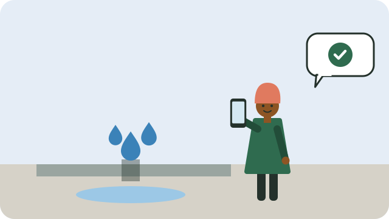

Water, electricity (in many areas), refuse removal, roads, and streetlights are municipal services. When something goes wrong, reporting it properly helps get it fixed.

## How to report

1. **Find the right number.** Most municipalities have a call centre, an SMS or WhatsApp line, or an app. The number is usually on your municipal account, the municipal website, or at the municipal office.
2. **Give clear details:** what the problem is, the exact address or nearest landmark, when it started, and how many homes are affected.
3. **Get a reference number.** Always ask for one, and write it down with the date and the name of the person you spoke to.

## If nothing happens

- Call again and give your reference number.
- Tell your **ward councillor**, with the reference number; see [[What ward committees do]].
- Report it at a ward meeting, so it is recorded.
- If neighbours have the same problem, report it together; see [[Starting a community group]].

## Emergencies

Some problems are dangerous: a fallen electricity cable, a burst main flooding houses, or a sewage spill. Report them at once, keep people away, and say clearly that it is an emergency.

> [!WARNING]
> Never touch a fallen electricity cable or anything touching it. Keep everyone, especially children, well away and report it immediately.

## Sources

- [Ward committees: connecting communities with municipalities (The Citizen)](https://www.citizen.co.za/heidelberg-nigel-heraut/news-headlines/local-elections-news/2026/10/12/the-role-of-ward-committees/)
- [Municipal ward committees: what you need to know (Vuk'uzenzele)](https://www.vukuzenzele.gov.za/municipal-ward-committees-what-you-need-know)
