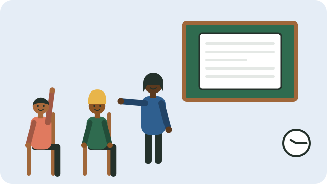

Good meetings are short, fair, and end with clear decisions. Poor meetings waste time and push people away.

## Before the meeting

- Write an **agenda**: a short list of what will be discussed, in order.
- Share it, with the date, time, and place, a few days before.
- Ask people to bring any reports, such as the treasurer's money report.

## During the meeting

1. **Start on time.** Welcome everyone and note who is present.
2. **Read the agenda**, and agree on it.
3. **Go through the last meeting's minutes**, and check what was done.
4. **Discuss each item in turn.** The chairperson gives everyone a chance to speak, keeps people on topic, and makes sure quieter members are heard.
5. **Make a clear decision** on each item, by agreement or by vote, and record it.
6. **Agree who will do what, by when.**
7. **Set the next meeting date**, and close on time.

## Minutes

The secretary writes short minutes: who was there, what was decided, and who will do what by when. Keep them safely; they are the group's memory and protect everyone when there is a disagreement later.

## Keeping it fair

- Agree on ground rules: one person speaks at a time, respect different views, and no personal attacks.
- Decide in advance how many members must be present for a decision to count (a "quorum").
- Declare an interest: anyone who could benefit personally from a decision should say so, and step out of the vote.

See also [[Starting a community group]].

## Sources

- [Having your say: a handbook for ward committees (PMG)](https://static.pmg.org.za/docs/WardHandbook.pdf)
