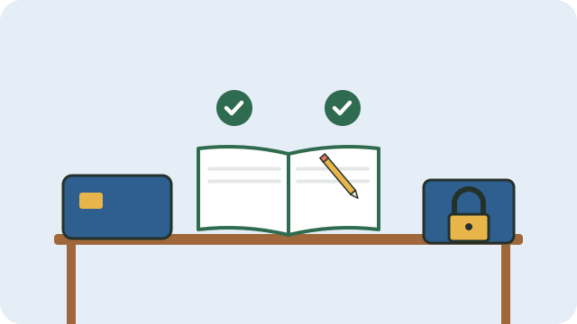

Disputes about money break up more groups than anything else. A few simple controls protect the money, and protect the treasurer from suspicion.

## Use a bank account in the group's name

- Never keep group money in one member's personal account.
- Require **two or three signatories**, so that no single person can take money out alone.
- Banks need the group's constitution, minutes naming the signatories, and their IDs and proof of address.

## Keep records

- Record every amount that comes in and goes out: date, amount, from or to whom, and why.
- Give a receipt for every payment received, and keep receipts or slips for every payment made.
- Keep the records in a book or a spreadsheet that more than one person can see.

## Report to members

- The treasurer reports at every meeting: money at the start, money in, money out, and money now.
- Show the latest bank statement, so members can check that the figures match.
- Once a year, ask someone who is not a signatory to check the records.

## Agree on rules for spending

- Write down who may approve spending, and up to what amount.
- Larger amounts need a decision at a meeting, recorded in the minutes; see [[Running a good meeting]].

> [!TIP]
> Avoid cash where you can. Electronic payments leave a record that protects everyone.

See also [[Saving with a stokvel]].

## Sources

- [Stokvels in South Africa: a complete guide to saving together (Debt Solutions)](https://www.debtsolutions4u.co.za/article/stokvel-guide-south-africa)
- [What should I look for in a well-run stokvel? (Smart About Money)](https://smartaboutmoney.co.za/saving-and-investing/investment-products/what-should-i-look-for-in-a-well-run-stokvel/)
