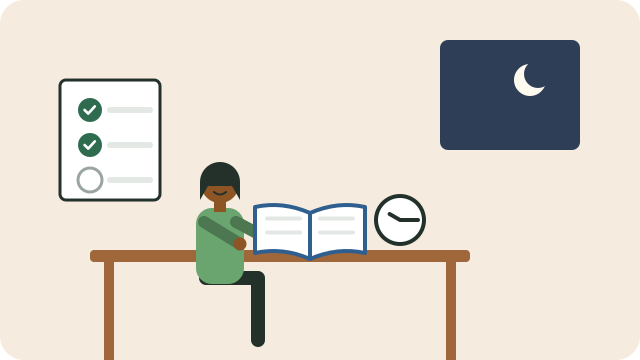

Adults often study around work and family. A few habits make that time count.

## Make time

- Short, regular sessions beat long, rare ones: 30 minutes on most days works better than four hours once a week.
- Use small gaps: on the taxi, in a queue, or before others wake up.
- Tell your family when you are studying, and ask for their support.

## Learn actively

- **Test yourself.** Close the book and write down or say what you remember, then check. This is one of the strongest ways to remember.
- **Space it out.** Go back to a topic after a day, then after a week.
- **Explain it** to someone else, even a child; if you can explain it simply, you understand it.
- **Write short notes** in your own words, with headings, so you can find things quickly. This app is a good place for them.

## Look after yourself

- Sleep is when the brain stores what you learned.
- Take short breaks, stand up, and drink water.
- Do not compare yourself with others; compare yourself with where you started.

## Ask for help

Ask your teacher or facilitator when you are stuck, and find a study partner or group. See [[Going back to learning]].

## Sources

- [CET colleges per province (ABET)](https://abet.co.za/learn/cet-colleges-per-province/)
