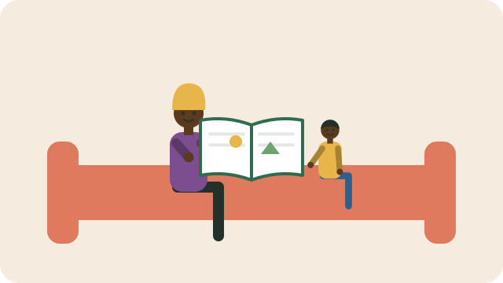

Reading aloud to children is one of the best things a family can do for their learning. It builds language, imagination, concentration, and a love of books, and it helps children learn to read for themselves.

## Start early, and start in your home language

- You can read to babies. They enjoy your voice and the pictures long before they understand the words.
- Read and tell stories in your **home language** first. Children learn best when they understand well, and a strong home language helps them learn other languages, including English, later.

## Make it a habit

- Aim for about **15 minutes a day**: at bedtime, after school, or while food cooks.
- Let children choose books, and read favourites again and again; repetition helps them learn.
- Books with **rhyme, rhythm, and repetition** are good for young children.

## It does not have to be a book

- Tell stories from your own childhood, or traditional stories.
- Sing songs and say rhymes together.
- Read anything: newspapers, signs, recipes, and labels.

## Talk about it

Ask questions as you read: "What do you think will happen next?" "How do you think she feels?" Let children retell the story in their own words.

## Finding books

- Use your **community library**; membership is usually free.
- Nal'ibali has free stories in all South African languages on its website.

See also [[Homework routines that help]].

## Sources

- [Parents' place (Nal'ibali)](https://nalibali.org/parents-place/)
- [Help your children to read and write at home, with Nal'ibali (News24)](https://www.news24.com/parent/Storytime/help-your-children-to-read-and-write-at-home-with-nalibali-20200512)
