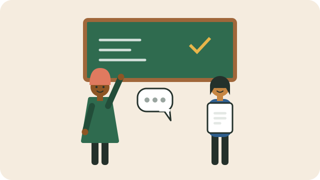

Children do better when their families and teachers work together.

## Parent meetings

Schools usually hold parent meetings each term, where you can see your child's work and progress. Go if you possibly can, and ask:

- How is my child doing, and where do they struggle?
- What can we do at home to help?
- Is my child happy and getting on with others?

## Raising a concern

- **Start with the class teacher.** Ask for a short meeting, or send a polite note.
- Be specific: what happened, when, and what you would like to happen.
- If it is not resolved, ask to see the head of department, then the principal.

## The school governing body (SGB)

Every public school has a **school governing body** made up of parents, teachers, other staff, the principal, and in high schools, learners. **Parents must be the majority**, and a parent chairs it. The SGB helps decide the school's policies, including its code of conduct, admission and language policies, and budget and fees.

Even if you are not on the SGB, you have a right to attend parent meetings about school policies and fees. You can also stand for election to the SGB.

See also [[Homework routines that help]].

## Sources

- [School governing bodies: a guide for parents and learners (Equal Education Law Centre)](https://eelawcentre.org.za/wp-content/uploads/school-governing-body-1.pdf)
- [Role of parents critical to well-functioning schools (GCIS)](https://www.gcis.gov.za/content/newsroom/blogs/2025-12/role-of-parents-critical-to-well-functioning-schools)
- [South African Schools Act, 1996 (SAFLII)](https://www.saflii.org/za/legis/consol_act/sasa1996228/)
