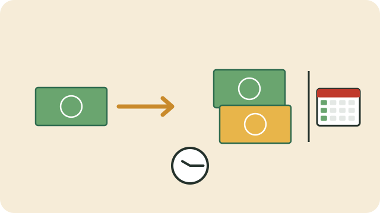

Credit means using someone else's money now and paying it back later, with extra on top. Store accounts, credit cards, personal loans, cellphone contracts, and home loans are all credit.

## What credit costs

- **Interest:** a percentage charged on what you owe, usually shown as a yearly rate.
- **Fees:** such as an initiation fee when the loan starts, and a monthly service fee.
- **Credit life insurance:** often added to cover the debt if you die or lose your job.

Together these can make a loan cost much more than the amount borrowed. Always look at the **total amount you will pay back**, not only the monthly instalment.

## Before you sign

- Do I really need this now, or can I save for it?
- What is the **total cost** of the credit, including interest, fees, and insurance?
- Can I afford the monthly payment **every month** until it is paid off, after my other costs?
- What happens if I miss a payment?

A lender must give you a quotation and the agreement in plain language, and must check that you can afford the credit. Read it before you sign, and keep a copy.

## Registered lenders only

In South Africa, credit providers must be registered with the **National Credit Regulator (NCR)**. You can check a lender on the NCR's website or by calling 0860 627 627. See [[Avoiding debt traps]].

## If you are struggling

If you cannot keep up with payments, act early: talk to the lender, or ask a registered **debt counsellor** about debt review. See also [[Your credit report]].

## Sources

- [Know your credit (National Credit Regulator)](https://www.ncr.org.za/documents/pages/NCR+KNOW+YOUR+CREDIT_POSTER+REVISION.compressed.pdf)
- [National Credit Regulator (Wikipedia)](https://en.wikipedia.org/wiki/National_Credit_Regulator)
