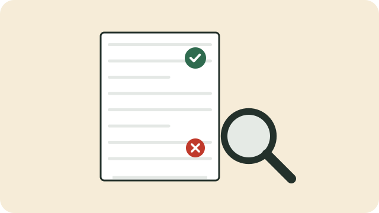

A credit report is a record of how you have handled credit: your accounts, how much you owe, and whether you have paid on time. Lenders, landlords, and some employers look at it before deciding about you.

## Get yours free

The National Credit Act gives you the right to **one free credit report every year from each registered credit bureau**. The main consumer bureaus are:

- TransUnion
- Experian
- Compuscan
- XDS

Request your report on each bureau's website, using your ID number. You do not have to pay for your yearly free report.

## What to check

- Are all the accounts yours? An account you do not recognise could mean someone is using your identity.
- Are the amounts and payment dates right?
- Are there "listings" (judgments or defaults) you did not know about?

## Fixing a mistake

1. Contact the credit bureau and say, in writing, what is wrong. Keep proof, such as a paid-up letter.
2. The bureau must look into it and tell you what it found.
3. If it is not fixed, you can complain to the Credit Ombud or the National Credit Regulator.

## Keeping a good record

- Pay at least the minimum, on time, every month.
- Keep your debts well below your limits.
- Do not apply for lots of credit at once.

See also [[How credit works]].

## Sources

- [Get one free copy of your credit report once a year (National Credit Regulator)](https://www.ncr.org.za/documents/pages/NCR+KNOW+YOUR+CREDIT_POSTER+REVISION.compressed.pdf)
- [Annual free credit report (TransUnion)](https://www.transunion.co.za/product/annual-free-credit-report)
- [A guide to the credit bureaus in South Africa (ClearScore)](https://www.clearscore.com/za/learn/credit-score-and-report/a-guide-to-the-credit-bureaus-in-south-africa)
