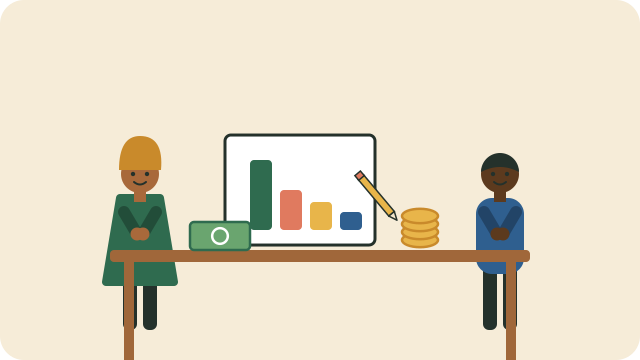

A budget is a plan for your money. It shows what comes in, what goes out, and what is left.

## Start with what you know

1. Write down the money that comes in each month: wages, grants, or other income.
2. List the costs you pay every month, such as rent, transport, electricity, and food.
3. Subtract the costs from the income.

## Look at the difference

- **Something left over?** Decide where it goes: savings, a goal, or paying off debt.
- **Not enough?** Look for costs you can lower, and start with the largest.

Check your plan each month. A budget is not a test; it is a tool you change as your life changes.

> [!NOTE]
> This is general information, not financial advice for your situation.

## Sources

- [Know your credit (National Credit Regulator)](https://www.ncr.org.za/documents/pages/NCR+KNOW+YOUR+CREDIT_POSTER+REVISION.compressed.pdf)
- [What should I look for in a well-run stokvel? (Smart About Money)](https://smartaboutmoney.co.za/saving-and-investing/investment-products/what-should-i-look-for-in-a-well-run-stokvel/)
