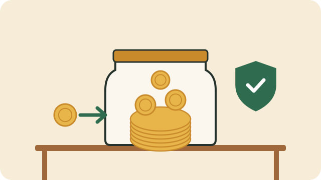

An emergency fund is money you set aside only for unexpected costs: a broken fridge, a funeral, a trip to hospital, or a month without work. Without one, an emergency often means borrowing at high interest.

## How much?

- **Start small.** A first goal of R500 or R1,000 already helps with many emergencies.
- **Then build up.** Over time, aim for enough to cover one month of essential costs, and later three.

## How to build it

1. **Decide a fixed amount** to save each month, even if it is small. Saving R100 every month gives R1,200 in a year.
2. **Save first, not last.** Move the money on payday, before other spending. Many banks can do this automatically.
3. **Keep it separate.** Use a separate savings account or pocket so you are not tempted to spend it.
4. **Add windfalls.** Put part of a bonus, a tax refund, or a stokvel payout into the fund.
5. **Refill it** after you use it.

## Where to keep it

Keep it somewhere safe that you can reach quickly but not too easily: a bank savings account or a savings pocket, rather than cash at home, which can be lost or stolen.

## What is an emergency?

Ask: is it **unexpected**, **necessary**, and **urgent**? School fees in January are not unexpected; plan for them in your budget instead. See [[Understanding household budgets]].

## Sources

- [What should I look for in a well-run stokvel? (Smart About Money)](https://smartaboutmoney.co.za/saving-and-investing/investment-products/what-should-i-look-for-in-a-well-run-stokvel/)
