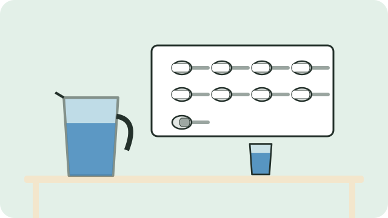

Diarrhoea is when a child passes three or more loose, watery stools in a day. The biggest danger is that the body loses too much water. Giving fluids early can prevent this.

## Make a sugar-salt drink

This is the recipe adapted by the Department of Health:

1. Boil 1 litre of water and let it cool.
2. Add **8 level teaspoons of sugar** and **half a level teaspoon of salt**.
3. Stir until the sugar and salt dissolve.
4. Taste it: it should be no saltier than tears.

Make a fresh mix every day. If you can get oral rehydration sachets (ORS) from the clinic or pharmacy, use them as the packet says.

## Give it often, in small sips

- Give the drink after every watery stool.
- For a child under 2 years, give at least a quarter to half of a large (250 ml) cup after each watery stool, a teaspoon every one or two minutes.
- If the child vomits, wait 10 minutes, then start again more slowly.

## Keep feeding

- Keep breastfeeding, even more often than usual.
- Keep giving the child's usual food, in small amounts.

> [!WARNING]
> Take the child to a clinic or hospital at once if the child cannot drink or breastfeed, vomits everything, is very sleepy or hard to wake, has blood in the stool, or has had diarrhoea for more than a few days. See [[Danger signs in a sick child]].

## Sources

- [Oral Rehydration Solution guidelines (City of Cape Town)](https://resource.capetown.gov.za/documentcentre/Documents/Procedures,%20guidelines%20and%20regulations/Oral%20Rehydration_Preparation%20Guidelines.pdf)
- [Treatment of diarrhoea (Africa Ahead, adapted from the Department of Health)](https://africaahead.org/sa-treatment-of-diarrhoea/)
