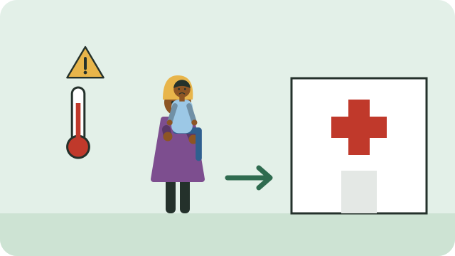

Most childhood illnesses can be cared for at home with rest, fluids, and food. But some signs show that a child is seriously ill and will quickly get sicker without treatment. Health workers call these **danger signs**.

## Go to a clinic or hospital at once if the child

- **cannot drink or breastfeed**,
- **vomits everything** they eat or drink,
- **has had a fit** (convulsions) during this illness, or
- **is very sleepy, floppy, or hard to wake**.

Even one of these signs means the child needs urgent care. Do not wait to see if it gets better.

## Other signs to take seriously

Take the child to a clinic the same day if they:

- breathe fast, or the chest pulls in when they breathe,
- have a high fever, especially a baby under 2 months,
- have diarrhoea with blood, or diarrhoea for 14 days or more,
- look very thin, or have swollen feet.

## While you travel

- Keep giving small sips of fluid if the child can swallow, such as the drink in [[When a child has diarrhoea]].
- Keep a baby warm, and keep breastfeeding if possible.
- Take the child's **Road to Health booklet** with you.

> [!WARNING]
> If a child is unconscious, having a fit, or struggling to breathe, call for emergency help (10177 from any phone, or 112 from a cellphone) or go to the nearest hospital straight away.

## Sources

- [Integrated Management of Childhood Illness: assess and classify the sick child (WHO)](https://cdn.who.int/media/docs/default-source/mca-documents/child/imci-integrated-management-of-childhood-illness/imci-in-service-training/imci-in_servicetraining_module_01.pdf?sfvrsn=eb5aec59_8)
- [Manual for the health care of children in humanitarian emergencies (WHO, NCBI)](https://www.ncbi.nlm.nih.gov/books/NBK143736/)
