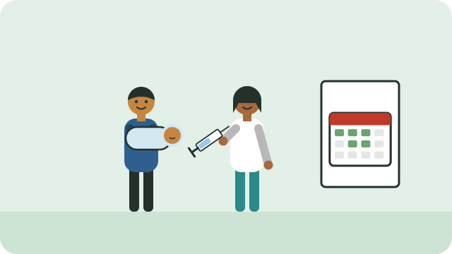

Vaccines protect children from serious diseases such as measles, polio, whooping cough, and some causes of pneumonia and severe diarrhoea. In South Africa, the vaccines in the national schedule are free at public clinics.

## The Road to Health booklet

Every child gets a **Road to Health booklet** at birth. It records the child's vaccines, growth, and development. Bring it to every clinic visit, and keep it safe.

## When babies are vaccinated

The schedule starts at birth and continues through childhood. The main early visits are:

| Age | Vaccines given (among others) |
|---|---|
| Birth | BCG (against TB) and polio drops |
| 6 weeks | Polio drops, rotavirus drops, the "6-in-1" injection, and pneumococcal injection |
| 10 weeks | The "6-in-1" injection (second dose) |
| 14 weeks | Rotavirus drops, the "6-in-1" injection (third dose), and pneumococcal injection |
| 6 months | Measles and rubella (first dose) |
| 12 months | Measles and rubella (second dose) |

There are more vaccines later, including a booster at 6 years and the HPV vaccine for girls at school. The clinic will tell you the date of the next visit and write it in the booklet.

## If a vaccine was missed

Do not start over. Go to the clinic with the booklet; the nurse will give the missed doses ("catch-up").

> [!NOTE]
> The schedule changes from time to time; the clinic and your child's Road to Health booklet have the current one. A mild fever or a sore leg after an injection is common and passes in a day or two.

## Sources

- [Primary Healthcare Standard Treatment Guidelines, Chapter 13: Immunisation (Department of Health, 2024)](https://www.health.gov.za/wp-content/uploads/2025/01/Primary-Healthcare-Chapter-13-Immunisation-with-supporting-NEMLC-report-update-Version-1.1-6-December-2024.pdf)
- [2025 revised childhood immunisation schedule (ECD Info Hub)](https://ecdinfohub.org/2025-revised-childhood-immunisation-schedule-epi-sa/)
