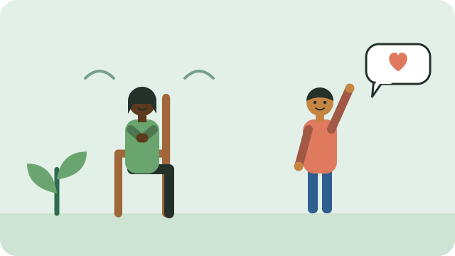

Everyone feels stressed sometimes: about money, work, family, health, or safety. A little stress can help us act. Too much, for too long, can affect sleep, mood, and health.

## Signs that stress is building up

- Trouble sleeping, or sleeping much more than usual
- Feeling tired, irritable, or on edge most of the time
- Headaches, a tight chest, or an upset stomach
- Not enjoying things you used to enjoy
- Drinking or smoking more to cope

## Things that help

- **Talk to someone you trust.** Sharing a worry often makes it lighter.
- **Move your body.** A walk, dancing, or work in the garden can lift your mood.
- **Keep a routine.** Regular meals and sleep times steady the mind.
- **Breathe slowly.** Breathe in for a count of four and out for a count of six, a few times.
- **Take small steps.** Break a big problem into one thing you can do today.
- **Limit alcohol.** It may feel like it helps, but it makes low moods worse.

## When to get help

If stress or sadness lasts for more than two weeks, gets in the way of daily life, or you have thoughts of harming yourself, it is time to speak to someone. See [[Where to find support]].

## Sources

- [South African Depression and Anxiety Group (SADAG)](https://www.sadag.org/index.php?option=com_content&view=article&id=11&Itemid=114)
