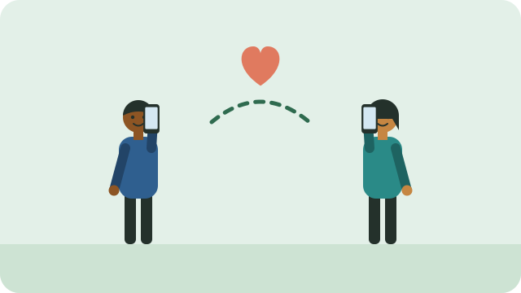

Asking for help is a sign of strength, not weakness. These services are free and confidential.

## Helplines

| Service | Number | When |
|---|---|---|
| SADAG Suicide Crisis Helpline | 0800 567 567 | 24 hours, every day |
| SADAG Mental Health Line | 011 234 4837 | Daily |
| LifeLine South Africa | 0861 322 322 | 24 hours |
| Substance Abuse Helpline (Social Development) | 0800 12 13 14, or SMS 32312 | 24 hours |

> [!IMPORTANT]
> If someone is in immediate danger of harming themselves, stay with them and call for help: 10177 for an ambulance, or 112 from a cellphone.

## Your clinic

Public clinics can screen for depression and anxiety, and refer you to a counsellor, psychologist, or doctor. You can ask the nurse directly: "I have been feeling low and would like to talk to someone."

## Helping someone else

- Listen without judging, and let them talk.
- Ask directly if they are thinking of harming themselves. Asking does not put the idea in their head.
- Help them call a helpline or go to the clinic.

See also [[Coping with stress]].

## Sources

- [SADAG suicide crisis helplines](https://www.sadag.org/index.php?option=com_content&view=article&id=3041&catid=149&Itemid=226)
- [Government contacts: SADAG Mental Health Line and Suicide Crisis Line (GCIS)](https://www.gov.za/sites/default/files/gcis_documents/contacts.pdf)
- [Suicide hotlines and crisis lines in South Africa (TherapyRoute)](https://www.therapyroute.com/article/suicide-hotlines-and-crisis-lines-in-south-africa)
