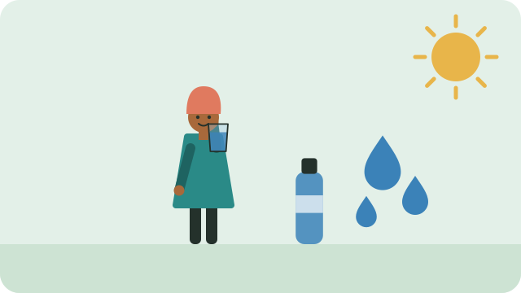

Hydration is part of everyday wellbeing. Small, regular choices make it easier to drink enough, especially on hot or busy days.

## Keep water close

- Keep a glass or bottle of clean water where you can see it.
- Have a drink with each meal.
- Take water with you when you travel or work outside.

## Notice what works for you

Thirst, activity, food, and the weather all change what your body needs. Build a routine that fits your day and the water you have. See [[Water through the day]] for ideas.

> [!NOTE]
> Needs differ from person to person. For a health concern, follow the advice of a nurse, doctor, or clinic.

## Sources

- [Food-based dietary guidelines for South Africa: drink lots of clean, safe water (FAO summary)](https://www.fao.org/nutrition/education/food-dietary-guidelines/regions/countries/south-africa/en/)
- [Dehydration: signs, symptoms, and treatment (Healthdirect)](https://www.healthdirect.gov.au/dehydration)
