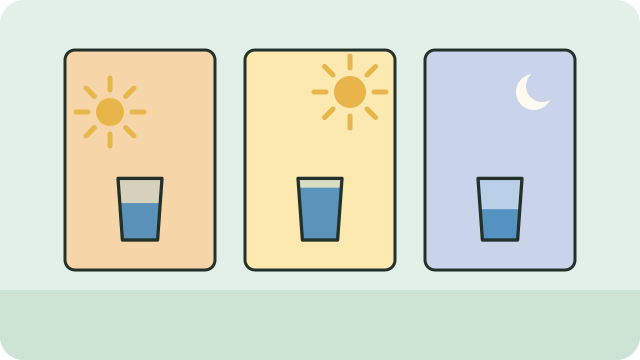

A routine is easier to keep than a target. These are moments many people find easy to remember.

1. When you wake up.
2. With breakfast, lunch, and supper.
3. When you take a break from work or chores.
4. Before and after walking or exercise.

> [!TIP]
> If you are not sure your water is safe to drink, bring it to a rolling boil first and let it cool, or ask your local clinic or municipality.

Back to [[Staying hydrated]].

## Sources

- [Food-based dietary guidelines for South Africa (FAO summary)](https://www.fao.org/nutrition/education/food-dietary-guidelines/regions/countries/south-africa/en/)
- [Oral Rehydration Solution guidelines, including boiling water (City of Cape Town)](https://resource.capetown.gov.za/documentcentre/Documents/Procedures,%20guidelines%20and%20regulations/Oral%20Rehydration_Preparation%20Guidelines.pdf)
