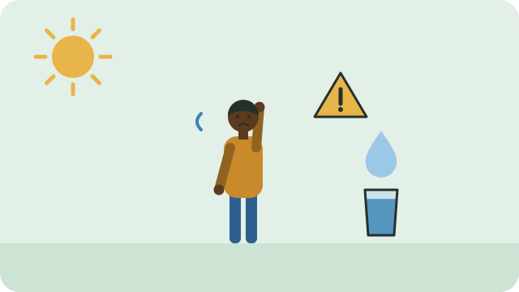

Dehydration means the body has lost more water than it has taken in. Mild dehydration is common on hot days, during illness, or after hard work, and drinking water usually helps.

## Common signs

- Feeling thirsty
- Dark yellow urine, or passing less urine than usual
- A dry mouth or lips
- Feeling tired, or having a headache

Babies, young children, and older people can become dehydrated more quickly, and may not say that they are thirsty.

> [!WARNING]
> Get medical help at once if someone is confused, faints, has not passed urine for many hours, or cannot keep fluids down. Go to your nearest clinic or call for emergency help.

To build steady habits, see [[Staying hydrated]] and [[Water through the day]].

## Sources

- [Dehydration: symptoms and causes (Mayo Clinic)](https://www.mayoclinic.org/diseases-conditions/dehydration/symptoms-causes/syc-20354086)
- [Dehydration: signs, symptoms, and treatment (Healthdirect)](https://www.healthdirect.gov.au/dehydration)
