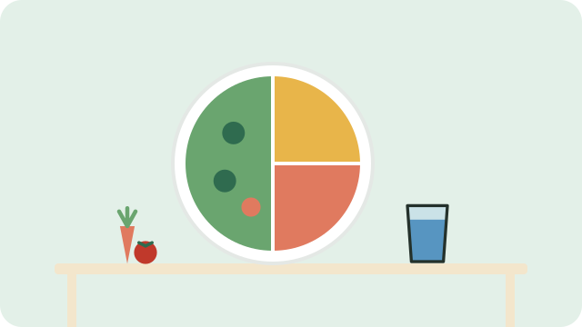

Eating well does not need special or expensive food. South Africa's food-based dietary guidelines describe a few simple habits that work for most families.

## The food groups

Try to include something from most of these groups every day:

- **Starchy foods** such as maize meal, brown bread, rice, potatoes, or samp. Make them part of most meals.
- **Vegetables and fruit**, plenty of them, every day. Dark green leaves like spinach and morogo, and orange ones like pumpkin and carrots, are especially good.
- **Dry beans, split peas, lentils, and soya**, regularly. They are cheap, filling, and full of protein.
- **Milk, maas, or yoghurt** every day.
- **Fish, chicken, lean meat, or eggs**, which can be eaten daily.

## Go easy on these

- Use fats sparingly, and choose vegetable oils rather than hard fats.
- Use sugar, and food and drinks high in sugar, sparingly.
- Use salt and salty food sparingly.

And drink lots of clean, safe water; see [[Staying hydrated]].

## Eating well on a budget

- Buy beans, lentils, and samp in bulk; they keep for months.
- Grow a few leafy greens at home; see [[Starting a kitchen garden]].
- Buy fruit and vegetables that are in season, when they are cheapest.
- Cook a big pot and share it over two meals.

> [!NOTE]
> Babies, pregnant women, and people with diabetes, high blood pressure, or other conditions may need different advice. Ask at your clinic.

## Sources

- [Food-based dietary guidelines for South Africa (FAO summary)](https://www.fao.org/nutrition/education/food-dietary-guidelines/regions/countries/south-africa/en/)
- [The South African Guidelines for Healthy Eating (ADSA)](https://adsa.org.za/wp-content/uploads/2023/06/Consumer-Guidelines-for-healthy-eating.pdf)
