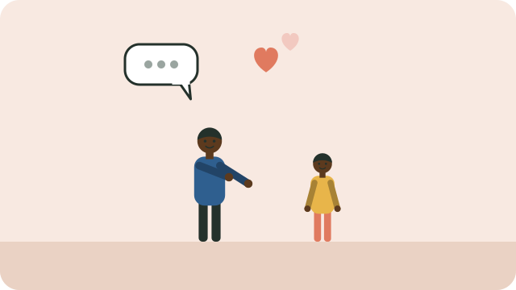

Discipline means teaching, not punishing. Positive discipline helps children learn how to behave by building a good relationship and setting clear expectations, without violence.

## Why not hitting?

Hitting and harsh shouting can stop a behaviour for a moment, but they create fear, damage trust, and teach children that hurting others is a way to solve problems. In South Africa, the Constitutional Court ruled in 2019 that physical punishment of children at home is not allowed.

## What works

- **Spend one-on-one time.** About 20 minutes a day of your full attention, playing, talking, or doing a chore together, encourages good behaviour.
- **Praise what you want to see.** "Thank you for packing away your toys." Praise effort: "I love how hard you're trying."
- **Give clear, positive instructions.** Say what to do, not only what not to do: "Please walk inside" rather than "Don't run."
- **Keep routines** for meals, homework, and bedtime; children behave better when they know what comes next.
- **Distract and redirect** young children: offer a different activity, or move to another room.
- **Use calm consequences.** Explain them in advance and keep them fair: if the ball is kicked at the window, the ball is put away for the afternoon.

## Look after yourself too

Parenting is hard. When you feel angry, take a breath, step away for a moment if the child is safe, and come back calmer. Ask family, friends, or a clinic for support.

UNICEF South Africa has free parenting tips, including **ParentText**, a WhatsApp service.

See also [[Reading with children]].

## Sources

- [How to discipline your child the smart and healthy way (UNICEF South Africa)](https://www.unicef.org/southafrica/unicef-parenting/child-care/how-discipline-your-child-smart-and-healthy-way)
- [UNICEF South Africa launches campaigns to champion play and positive parenting](https://www.unicef.org/southafrica/press-releases/unicef-south-africa-launches-dual-campaigns-champion-play-and-positive-parenting)
- [UNICEF supports landmark moment for child rights in South Africa](https://www.unicef.org/southafrica/press-releases/unicef-supports-landmark-moment-child-rights-south-africa)
