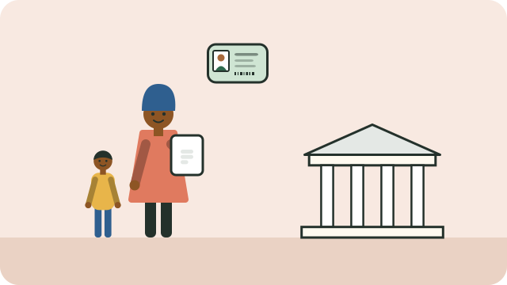

The **child support grant** is a monthly payment from the South African Social Security Agency (SASSA) to help caregivers with low incomes look after children.

## Who can apply

- The child's **primary caregiver**: the person who looks after the child day to day. This can be a parent, grandparent, aunt, or another person, not only the mother.
- The caregiver must be a South African citizen, permanent resident, or recognised refugee, and live in South Africa with the child.
- The child must be **under 18**.
- The caregiver's income must be below a limit (a "means test"); the limit is higher for married couples. SASSA can tell you the current limit.

The amount is set each year in the national budget; ask SASSA for the current amount.

## What to bring

- Your **13-digit bar-coded ID** (or smart ID card).
- The child's **birth certificate**; see [[Registering a birth]].
- Proof of income, or a sworn statement if you have none, and recent bank statements if you have an account.
- Proof of address, and proof of marital status if it applies.
- If you are not the child's parent: proof that you are the primary caregiver, such as an affidavit from a police official, a social worker's report, or a letter from the child's school.

## How to apply

- Go to your nearest **SASSA office**. An official will help you fill in the form and take your fingerprints.
- You can also start an application online at services.sassa.gov.za.
- **Applying is free.** Never pay anyone to help you apply.

## Sources

- [Child support grant (South African Government)](https://www.gov.za/services/child-care-social-benefits/child-support-grant)
- [How to apply for a child support grant (Sikunye)](https://sikunye.org.za/wp-content/uploads/How-to-apply-for-a-child-support-grant-1.pdf)
