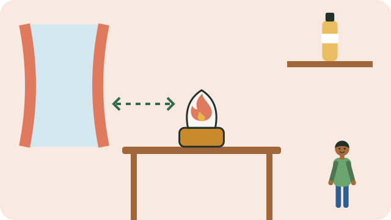

Paraffin is used in many homes for cooking, heating, and light. Used carelessly, it causes fires and burns, and children are often poisoned by drinking it.

## Using a paraffin stove or heater

- Stand it on a **flat, firm surface**, away from curtains, bedding, and anything that can burn.
- Do not put a cloth under it: a child or pet could pull the cloth and tip it over.
- **Never leave it burning unattended**, and turn it off before you leave the room or go to sleep.
- **Never refill it while it is lit or still hot.** Let it cool first, and refill outdoors if you can.
- Keep a window slightly open for fresh air. Burning paraffin in a closed room can make you ill.
- Use appliances that meet safety standards, and replace damaged ones.

## Storing paraffin

- Buy and keep paraffin in a container with a **child-resistant cap**.
- **Never store paraffin in a cooldrink or milk bottle.** A thirsty child could mistake it for a drink.
- Keep it out of children's reach, away from matches, lighters, and the stove.

## If a child drinks paraffin

- **Do not make the child vomit.** Paraffin that goes into the lungs is what makes children very ill.
- Take the child to a clinic or hospital at once. Take the container with you.
- For advice on the way, call the **Poisons Information Helpline: 0861 555 777** (24 hours).

## If there is a fire

- Get everyone out, and call for help.
- Smother a small fire with a damp blanket or sand. **Never throw water on burning paraffin**; it spreads the flames.

See also [[First aid for burns]].

## Sources

- [Paraffin safety in the home (City of Cape Town)](https://www.capetown.gov.za/family-and-home/safety-in-the-home/basic-household-safety/paraffin-safety-in-the-home/)
- [Be careful with paraffin: keeping warm safely (Vuk'uzenzele)](https://www.vukuzenzele.gov.za/be-careful-paraffin-keeping-warm-safely)
- [Paraffin Safety Association of Southern Africa (Wikipedia)](https://en.wikipedia.org/wiki/Paraffin_Safety_Association_of_Southern_Africa)
- [Help! My child swallowed something poisonous (BabyYumYum)](https://babyyumyum.com/help-my-child-swallowed-something-poisonous/)
- [Paediatric Standard Treatment Guidelines, Chapter 18: Poisoning (Department of Health)](https://knowledgehub.health.gov.za/system/files/elibdownloads/2023-12/PaedCHp%2018_Poisoning_2023.pdf)
