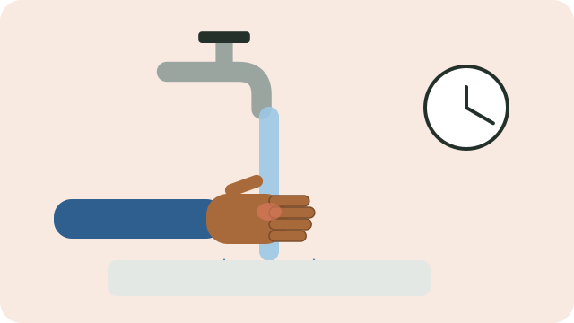

Burns from hot water, stoves, paraffin, and fires are common, especially among young children. The right first aid in the first minutes makes a big difference.

## What to do

1. **Stop the burning.** Move away from the heat. If clothes are on fire: stop, drop, and roll, or smother the flames with a blanket.
2. **Cool the burn under cool running water for at least 20 minutes.** This reduces pain and damage, and still helps up to three hours after the burn.
3. **Remove** rings, watches, and clothing near the burn, unless they are stuck to the skin.
4. **Cover the burn** loosely with a clean, non-fluffy cloth or cling wrap.
5. **Keep the person warm.** Cool only the burn, not the whole body, especially with babies and small children.

## Do not

- Do not use ice or iced water.
- Do not put butter, oil, toothpaste, egg, or other home remedies on a burn.
- Do not burst blisters.

## Get medical help at once if

- the burn is larger than the person's palm,
- it is on the face, hands, feet, genitals, or across a joint,
- the skin looks white, leathery, or charred,
- the person breathed in smoke, or the burn is from electricity or chemicals, or
- the person is a baby, a young child, or an older person.

> [!WARNING]
> For a serious burn, call for emergency help (10177, or 112 from a cellphone) and keep cooling the burn while you wait.

See also [[Using paraffin safely]].

## Sources

- [Burns and scalds: first aid, treatments, causes, and prevention (Healthdirect)](https://www.healthdirect.gov.au/burns-and-scalds)
- [Burns and scalds in children (Better Health Channel)](https://www.betterhealth.vic.gov.au/health/conditionsandtreatments/burns-and-scalds-children)
- [Learn first aid for burns (British Red Cross)](https://www.redcross.org.uk/first-aid/learn-first-aid/burns)
