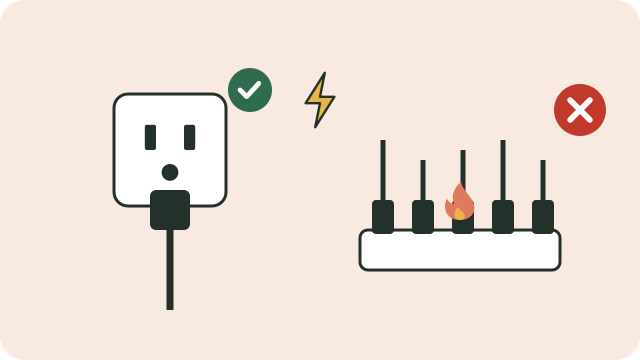

Electricity makes life easier, but faulty wiring, overloaded plugs, and illegal connections cause shocks, fires, and deaths every year.

## Plugs and cords

- **Do not overload a plug point.** Running a kettle, heater, and stove from one plug or adaptor makes it overheat and can cause a fire.
- Replace cords that are cut, cracked, or have bare wire.
- Keep cords away from water, and never touch switches or appliances with wet hands.
- Switch appliances off at the wall when you are not using them.

## The earth leakage unit

An **earth leakage unit** in the distribution board switches the power off within a fraction of a second if current leaks, for example through a person. It can save a life. Test it by pressing its test button every few months; if it does not trip, call a qualified electrician.

## Illegal connections

Illegal connections (izinyoka) use unsafe, uninsulated wires, often lying on the ground or hanging low. They have killed children and adults, and they overload the network and cause fires. Report them to Eskom on **0800 11 27 22** or to your municipality.

## Children

- Cover unused plug points with safety caps.
- Teach children not to play with plugs, cords, or switches.
- Never let children climb poles, or fly kites near power lines.

> [!WARNING]
> Never touch a fallen power line or anything touching it. Keep everyone away and report it immediately. If someone is being shocked, do not touch them: switch off the power first, or push the person away with something dry that does not conduct, like a wooden broom handle.

See also [[First aid for burns]].

## Sources

- [Electricity safety tips (Eskom)](https://www.eskom.co.za/about-eskom/about-electricity/public-safety/)
- [Eskom cautions against illegal connections (SAnews)](https://www.sanews.gov.za/south-africa/eskom-cautions-against-illegal-connections)
- [Essential electricity safety tips (Property24)](https://www.property24.com/articles/essential-electricity-safety-tips/20429)
