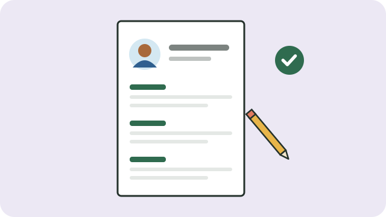

A CV (curriculum vitae) is a short summary of who you are, what you can do, and what you have done. It is often the first thing an employer sees, so make it clear and easy to read.

## What to include

1. **Your details:** full name, phone number, email address, and the area where you live. You do not need to include your ID number, age, or a photo unless asked.
2. **A short profile:** two or three sentences about your strengths and the kind of work you want.
3. **Work experience:** your jobs, newest first, with dates and what you did. Include piece work, volunteering, and helping in a family business; they count.
4. **Education and training:** your highest grade or qualification, and short courses.
5. **Skills:** languages you speak, driver's licence, computer skills, and practical skills.
6. **References:** two people who can speak about your work, such as a past employer or teacher. Ask them first.

## Tips

- Keep it to **one or two pages**.
- Use a simple layout, and check spelling carefully. Ask someone else to read it.
- Change it for each job, putting first what matters most for that job.
- Save it as a PDF if you email it.

## Where to look for work

- **ESSA**, the Department of Employment and Labour's free job-seeker system (essa.labour.gov.za), where you can register, build a CV, and apply. Labour centres can help you register.
- **SAYouth** (sayouth.mobi) for young people looking for work and learning opportunities.
- Notice boards, community radio, and people you know.

> [!WARNING]
> Real employers never ask you to pay for a job. See [[Spotting job scams]].

Next: [[Preparing for an interview]].

## Sources

- [Employment Services of South Africa (Department of Employment and Labour)](https://essa.labour.gov.za/EssaOnline/WebBeans/)
- [Steps to apply for opportunities on ESSA (Department of Employment and Labour)](https://www.labour.gov.za/DocumentCenter/Publications/Public%20Employment%20Services/Steps%20to%20apply%20for%20opportunities%20on%20ESSA%20system.pdf)
