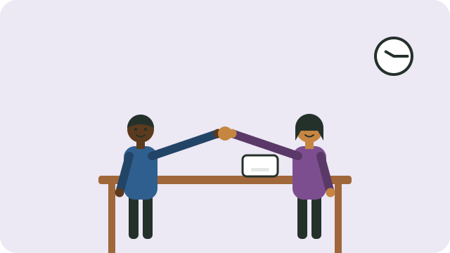

An interview is a conversation: the employer wants to know if you can do the job and will fit in, and you want to know if the job suits you.

## Before the day

- **Learn about the employer:** what they do, and what the job involves.
- **Practise answers** to common questions out loud, with a friend if possible.
- **Plan your journey** so that you arrive 10 to 15 minutes early.
- Prepare clean, neat clothes suited to the job.

## What to bring

- Copies of your CV; see [[Writing a CV]].
- Your ID and certified copies of certificates, if asked.
- A pen, and the name of the person you are meeting.

## Common questions

- **"Tell us about yourself."** Give a short summary of your experience and strengths, linked to the job.
- **"Why do you want this job?"** Show what you know about the work and why it suits you.
- **"Tell us about a time when..."** Describe the situation, what you did, and the result.
- **"What are your weaknesses?"** Name a real one, and what you do to improve it.

At the end, ask a question of your own, such as "What would a normal day look like?" or "When will you decide?"

## During the interview

- Greet everyone politely, and switch off your phone.
- Listen carefully, and take a moment to think before you answer.
- Be honest; do not claim skills you do not have.

## After

Send a short thank-you message, and keep looking while you wait.

## Sources

- [Employment Services of South Africa (Department of Employment and Labour)](https://essa.labour.gov.za/EssaOnline/WebBeans/)
