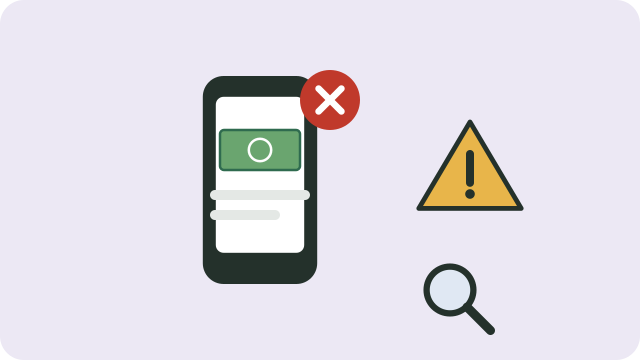

Criminals take advantage of people who need work. They promise jobs and then ask for money or personal details.

## The golden rule

**Never pay for a job.** In South Africa it is illegal to ask someone to pay for a job, and the Department of Employment and Labour warns work seekers not to pay any "fee", even one that is called "fully refundable".

## Warning signs

- You are asked to pay for "registration", "training", "uniforms", a "background check", or a "medical test" before you start.
- The offer comes through WhatsApp or social media from someone you do not know, often using the name or logo of a government department or a big company.
- You are offered a job without an interview, or for a job you never applied for.
- The pay seems too good for the work.
- You are pressured to decide or pay quickly.
- They ask for your bank details, PIN, or copies of your ID early on.

## Protect yourself

- Check the job on the employer's official website or by calling their official number, not the number in the message.
- Do not share your ID number, bank details, or PIN with someone you do not know.
- Use trusted job sites; see [[Writing a CV]].

## If you are targeted

Report it to the **South African Police Service**, or to the Department of Employment and Labour's fraud hotline on **0860 22 194** or fraud@labour.gov.za.

## Sources

- [Department of Employment and Labour cautions the public not to part with hard-earned cash](https://www.labour.gov.za/department-of-employment-and-labour-cautions-public-not-to-part-ways-with-hard-earned-cash)
- [Labour department warns job seekers (SAnews)](https://www.sanews.gov.za/south-africa/labour-dept-warns-job-seekers)
- [Work seekers warned not to fall for jobs scam (allAfrica)](https://allafrica.com/stories/202402050380.html)
