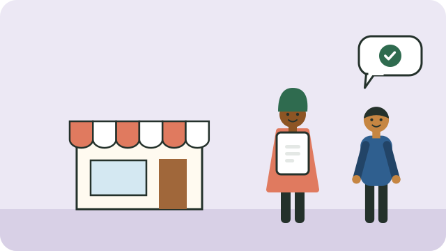

Many small businesses fail because they start before checking that enough people will buy, at a price that covers the costs. Testing first saves money and heartache.

## Ask three questions

1. **Who will buy, and why?** Name your customers: neighbours, commuters, schools, small shops. What problem do you solve for them?
2. **Who else sells it?** Look at competitors' prices and quality. How will you be different: closer, cheaper, faster, friendlier, or better?
3. **Can you make a profit?** Add up what one item or job costs you (materials, transport, data, your time), and compare it with what customers will pay.

## Test small

- Make a small batch, or offer the service to a few people first.
- Ask for honest feedback, and watch what people actually buy, not only what they say.
- Keep track of every rand in and out from the first day; see [[Keeping simple business records]].

## Work out your prices

Price = what it costs you + a fair profit. If customers will not pay that, find ways to lower costs, or change the idea.

## Start lean

- Use what you already have before buying equipment.
- Grow from your profits rather than from loans where you can; see [[How credit works]].

When the idea works, see [[Registering a business]].

## Sources

- [How to register a business in South Africa: cost and steps (iKhokha)](https://www.ikhokha.com/blog/what-is-required-to-register-a-company-in-south-africa)
