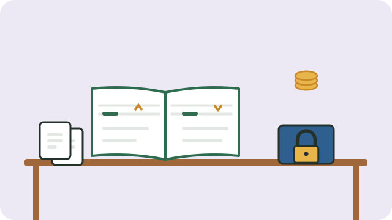

You cannot manage what you do not measure. Simple records show whether your business is making money, help you plan, and are needed for tax and for any loan.

## Keep business money separate

Use a separate bank account or at least a separate tin or pocket for business money. Pay yourself a fixed amount, rather than taking money whenever you need it.

## A simple cash book

Write down every amount, every day:

| Date | Description | Money in | Money out |
|---|---|---|---|
| 3 May | Sold 20 vetkoek | R100 | |
| 3 May | Bought flour and oil | | R65 |

At the end of each week, add up money in and money out. Keep slips and receipts in an envelope for each month.

## Each month, check

- **Total sales** (money in)
- **Total costs** (money out)
- **Profit** = sales minus costs
- What sold best, and what did not?

## Other records

- What customers owe you, and what you owe suppliers.
- Stock: what you have, so you know when to buy more.

## Tax

When your business earns enough, you will need to register with the **South African Revenue Service (SARS)** for income tax. SARS has a simpler "turnover tax" for small businesses. Ask at a SARS branch or on its website what applies to you.

See also [[Testing a business idea]].

## Sources

- [How to register a company in South Africa (Citizen Help)](https://www.citizenhelp.co.za/business/how-to-register-a-company-south-africa)
