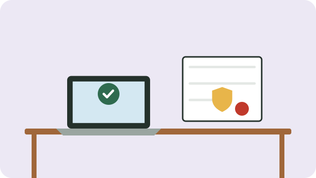

You do not always need to register to start trading. Choose what fits your business.

## Sole proprietor: nothing to register

If you work on your own, as a freelancer or a one-person business, you are a **sole proprietor** by default. There is **nothing to register with the Companies and Intellectual Property Commission (CIPC)**. You and the business are the same person: you keep the profits, and you are personally responsible for its debts.

You still need to declare your income to SARS when it is high enough, and some kinds of business need a municipal trading permit or licence, for example for selling food.

## A private company (Pty) Ltd

Register a company when you want it to be legally separate from you, so that your personal belongings are protected from its debts, or when customers or funders ask for company documents.

- Register online through **BizPortal** (bizportal.gov.za) or CIPC's eServices.
- At the time of writing, it costs about **R175**: R50 to reserve a name and R125 to register. Check the current fees on the site.
- Approval often takes one to seven working days.
- A company must file an **annual return** with CIPC every year, and keep records.

> [!WARNING]
> Be careful of agents who charge large fees for registration you can do yourself online, and of messages claiming your company will be closed unless you pay someone urgently. Check directly with CIPC.

## Where to get help

Your local municipality's business support office, and government agencies for small business, can advise and sometimes support with training or funding.

See also [[Keeping simple business records]].

## Sources

- [How to register a company with CIPC on BizPortal (Small Business Directory)](https://smallbusinessdirectory.co.za/register-a-company-with-cipc-on-bizportal/)
- [How to register a company directly with CIPC (GovChain)](https://www.govchain.co.za/blog/how-to-register-a-company-directly-with-cipc)
- [How much does it really cost to register a business in South Africa? (NextStep)](https://nextstepza.co.za/cost-to-register-a-business-south-africa/)
