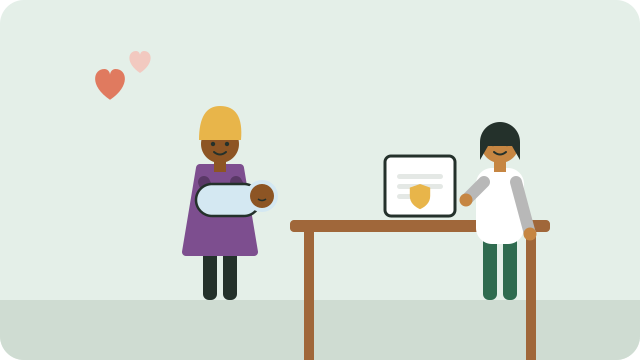

A birth certificate proves who a child is and that they are South African. A child needs it to get an ID later, to apply for the child support grant, and to enrol at school.

## Register within 30 days

The law says a birth must be registered **within 30 days**. Registering within 30 days is **free**, and you receive an unabridged birth certificate free of charge.

Many hospitals and clinics have a **Home Affairs office** inside, so you can register the birth before you go home. If not, go to your nearest Home Affairs office.

## What to bring

- The **proof of birth** from the hospital or clinic, stamped, or the clinic card.
- The **IDs of the parents**.
- If the parents are **not married**, and the father's details are to be on the certificate, **both parents** should go in person to sign and acknowledge paternity.

## If the 30 days have passed

You can still register the birth, but it is called a **late registration**, and more documents and steps are needed. Do it as soon as possible; ask at Home Affairs what to bring.

> [!TIP]
> Keep the birth certificate somewhere safe and dry, and make copies. You will need it for the child's ID at 16; see [[Getting your ID]].

## Sources

- [Register your child within 30 days of birth (Department of Home Affairs)](https://www.dha.gov.za/files/Brochures/NPRhospitals.pdf)
- [Citizenship and birth registration (Legal Aid South Africa)](https://legal-aid.co.za/citizenship/)
