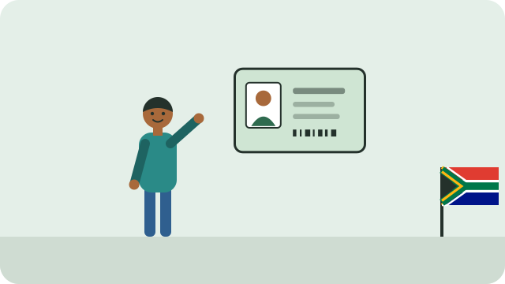

Your identity document proves who you are. You need it to open a bank account, apply for a job or a grant, register to vote, and much more.

## Your first ID

- South African citizens can apply from the age of **16**.
- Your **first ID is free**. Home Affairs now issues the **smart ID card**, which replaces the green ID book.
- Bring your **birth certificate**; see [[Registering a birth]]. A parent or guardian with their ID may need to come with you; ask your office.

## Where to apply

- At a **Home Affairs office**.
- At some **bank branches** that offer Home Affairs services. Book through the eHomeAffairs website, where you can also pay fees for re-issues online.

Your photo and fingerprints are taken when you apply. You collect the card when you receive a message that it is ready.

## Replacing an ID

If your ID is lost, stolen, or damaged, apply for a replacement. A re-issued smart ID costs a fee (about **R140** at the time of writing; check the current fee). If you need ID urgently while you wait, you can ask for a **temporary identity certificate**.

> [!WARNING]
> Never give your ID to a lender to keep as security for a loan. It is illegal for them to hold it; see [[Avoiding debt traps]].

See also [[Registering to vote]].

## Sources

- [How to apply for a smart ID card (Citizen Help)](https://www.citizenhelp.co.za/home-affairs/smart-id)
- [Smart ID card cost (ID Checker)](https://idchecker.co.za/smart-id-card-cost-south-africa/)
- [Home Affairs bank branches for smart ID and passports (ID Checker)](https://idchecker.co.za/home-affairs-bank-branches/)
