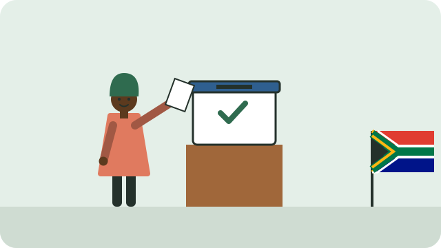

To vote in South Africa's elections, you must first be **registered** on the voters' roll, in the voting district where you live.

## Who can register

- South African citizens with an **ID**: a smart ID card, green bar-coded ID book, or a valid temporary identity certificate; see [[Getting your ID]].
- You can register from **16**, and vote from **18**.

## How to register

- **Online:** at registertovote.elections.org.za, the Electoral Commission's (IEC) official site. You will receive an SMS confirming your registration.
- **In person:** at your local IEC office during office hours, or at your voting station on registration weekends before elections.

Register **where you live**, and update your address when you move. You can only vote where you are registered.

## Check your registration

- On the IEC website (elections.org.za), under "Am I registered?".
- At your local IEC office.

> [!IMPORTANT]
> Registration closes when an election is officially called, so register or check your details early.

See also [[Your rights in the Constitution]].

## Sources

- [Voter registration FAQ (Electoral Commission of South Africa)](https://www.elections.org.za/content/For-Voters/FAQ--Voter-registration/)
- [How to register to vote (Electoral Commission of South Africa)](https://www.elections.org.za/pw/Documents/Outreach/Factsheets/Voter%20registration/IEC%20How%20to%20Register%20to%20Vote%20Factsheet.pdf)
- [Online voter registration (Electoral Commission of South Africa)](https://www.elections.org.za/pw/Documents/Outreach/Factsheets/Voter%20registration/IEC%20Online%20Voter%20Registration%20Factsheet.pdf)
