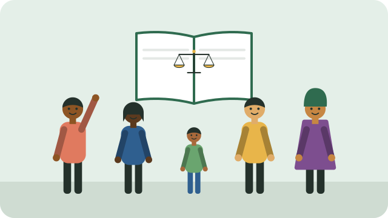

South Africa's **Constitution** (1996) is the highest law in the country. Its **Bill of Rights**, Chapter 2, sets out rights that apply to **everyone in South Africa**. The state must respect, protect, promote, and fulfil them.

## Some of the rights in the Bill of Rights

- **Equality:** everyone is equal before the law, and no one may be unfairly discriminated against, for example because of race, gender, pregnancy, disability, religion, language, or sexual orientation.
- **Human dignity**, and the **right to life**.
- **Freedom and security of the person**, including the right to be free from all forms of violence.
- **Privacy**.
- **Freedom of religion, belief, and opinion**, and **freedom of expression**.
- **Assembly, demonstration, and petition**, peacefully and unarmed.
- **Political rights**, including the right to vote; see [[Registering to vote]].
- **Fair labour practices**, and to form and join trade unions.
- **An environment** that is not harmful to health or well-being.
- **Access to adequate housing**, **health care**, **sufficient food and water**, and **social security**, which the state must work towards within its available resources.
- **Children's rights**, including to a name and nationality from birth, to family care, to basic nutrition and health care, and to be protected from abuse and neglect.
- **Basic education**, including adult basic education.
- **Language and culture**: to use the language and take part in the cultural life of your choice.
- **Access to information** held by the state.
- **Just administrative action**: decisions by government officials must be lawful, reasonable, and fair.
- **Access to courts**, and the rights of arrested, detained, and accused people.

## Rights come with limits

Rights can be limited only by a law that applies to everyone, and only if the limit is reasonable and justifiable in an open and democratic society.

If your rights are not respected, see [[Getting help with a rights problem]].

## Sources

- [South African Human Rights Commission](https://www.sahrc.org.za/)
- [Where can I get legal advice if I cannot afford to pay? (South African Government)](https://www.gov.za/faq/justice-and-crime-prevention/where-can-i-get-legal-advice-if-i-cannot-afford-pay)
