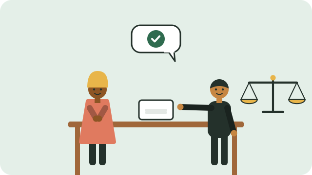

If your rights are not respected, you do not have to face it alone, and you do not need money to get help.

## Free legal advice: Legal Aid South Africa

Legal Aid South Africa gives free legal advice to anyone, and free legal representation in court to people who cannot afford a lawyer and qualify.

- **Advice Line: 0800 110 110** (free, weekdays 7am to 7pm)
- Or send a "Please Call Me" to **079 835 7179**, and they will call you back.
- Or visit a Legal Aid local office or Justice Centre.

## Human rights violations: the Human Rights Commission

The **South African Human Rights Commission (SAHRC)** deals with violations of the rights in the Bill of Rights, such as unfair discrimination or denial of basic services. Complaints are **free**. The SAHRC can investigate, mediate, and take matters to court.

- Phone **011 877 3600**, or visit sahrc.org.za.

## Other places to go

- **Community advice offices** in many towns give free advice on grants, labour, housing, and family problems.
- **The Public Protector** investigates improper conduct by government departments and officials.
- **The Commission for Conciliation, Mediation and Arbitration (CCMA)** handles unfair dismissal and workplace disputes.
- **The police (SAPS)** for crimes. You have a right to have a case opened and to receive a case number.

## Before you go

- Write down what happened, when, where, and who was involved.
- Keep copies of documents, letters, and messages.
- Note the names of officials you speak to, and any reference numbers.

See also [[Your rights in the Constitution]].

## Sources

- [Legal advice (Legal Aid South Africa)](https://legal-aid.co.za/legal-advice/)
- [Where can I get legal advice if I cannot afford to pay? (South African Government)](https://www.gov.za/faq/justice-and-crime-prevention/where-can-i-get-legal-advice-if-i-cannot-afford-pay)
- [Frequently asked questions (Department of Justice)](https://www.justice.gov.za/faq.html)
