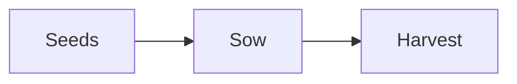

# The Personal Knowledge Library - Complete App Guide

This guide describes the current implementation of the app: how to use it,
where it stores data, how to preserve that data, and how the application is
organized for development. It covers shipped functionality, not every idea in
the product roadmap.

## 1. Product overview

The Personal Knowledge Library is a responsive, offline-first Progressive Web App (PWA) for taking
notes and building a personal knowledge library. It is designed around local
ownership of data, quick capture, flexible organization, and safe recovery.

### Product principles

- **Local by default:** the app uses browser storage; core note-taking does not
  depend on an account, application server, or cloud provider.
- **Offline capable:** the installable app shell is cached for later use.
- **User-controlled:** export and import provide a portable backup path.
- **Progressive:** media recording and playback depend on browser support and
  permissions rather than a separate media service.
- **Accessible and responsive:** navigation, editors, dialogs, and graph views
  are designed for keyboard use, assistive technology, and different screen
  sizes.

AI summaries and semantic search are not part of the current application.
Search remains local text matching; note content is not sent to an AI service.

## 2. Feature guide

### 2.1 Home, notes, and the workspace

The app opens on **Home** (address `#/`), the library entrance:

- a welcome, and **Continue reading**: the note opened last, personal or
  handbook, with where it sits ("Health & Wellbeing / Nutrition / Everyday
  Nutrition · Note 2 of 2") and a **Continue reading** button. With nothing read
  yet, it invites you to choose a library instead.
- **Explore libraries**: a tile for each handbook library, with what it covers,
  then your own libraries.
- **Recently added**: the five newest handbook notes and personal notes, with
  where they sit and the date.
- **Available offline** once the app is installed for offline use, or **You are
  offline** when there is no connection; nothing is shown when neither is known.

There are no counts styled as scores, feeds, or charts. Home is drawn straight
away, before your notes have loaded, since the handbooks need no database. It
is the first item in the sidebar and the collapsed rail, the start of every
breadcrumb, and where the app's name in the sidebar leads.

Create a note from the workspace's **New note** action. Edit its title and
Markdown content in the note editor. Notes are saved locally with creation and
update timestamps. The workspace provides the global **All Notes** view (address `#/notes`) as
well as narrower views for favorites, Trash, notebooks, tags, libraries, and
shelves.

Each card shows the start of its note as it reads, without formatting marks:
headings in bold, bullets, numbered items, and checkboxes, with tables, code,
formulas, diagrams, and images shown as a labelled chip ("Table").

Pinned notes are prioritized at the top of the note list. Favorites have a
dedicated view. Notes can be moved between notebooks, and notebooks can be
organized into shelves and libraries.

The note grid only renders the cards near the visible part of the page and
adds more as you scroll, so large libraries stay fast. Screen readers still
hear each card's position, such as "5 of 10,000". The browser's own find
(Ctrl+F) only sees the cards currently on the page; use the app's search to
find any note.

#### Navigation on desktop, tablet, and phone

On wide screens (1200 pixels and above), the sidebar is visible by default,
264 pixels wide. Its **Collapse sidebar** button (top right of the sidebar)
narrows it to a 72-pixel rail of icons: **Expand sidebar**, **New note**, **All
Notes**, **Favorites**, **Note map**, **Today's note**, **Trash**, and
**Settings**. Each icon has a name for screen readers and shows it in a tooltip
on hover or keyboard focus, and the current page is marked by a bar as well as
colour. On tablets and phones (1199 pixels and below), the header's menu button
opens a navigation drawer instead. The drawer closes with its close button, on
Escape, when the backdrop is tapped, or when a destination is selected, and
returns focus to the menu button when dismissed. Its contents scroll
independently of the page.

A **Skip to main content** link comes first in the keyboard order (Option+Tab
in Safari) and moves focus straight to the page.

#### Page addresses, Back, and Forward

Every page has its own address after `#` in the browser's address bar, for
example `#/notebook/<id>` for a notebook. An open note adds `?note=<id>`, and a
search adds `?q=<words>`. So:

- **Back** and **Forward** move between the pages and notes you opened. After
  Back or Forward, focus moves to the page's heading so screen readers announce
  it.
- **Reloading** keeps the same page, note, and search.
- An address can be **bookmarked** or opened in a new tab; breadcrumb links can
  be opened in a new tab too.
- Typing a search updates the address without adding a step to the history for
  each letter.
- An address for a page or note no longer in the library opens All Notes, with
  a notice saying the page is no longer in your library or the note could not
  be found.

The browser tab's title names the page or the open note, followed by the app's
name. Addresses use the part after `#`, so they work on any static host and
offline.

#### Command palette

Press **Ctrl+K** (**⌘K** on a Mac), or select the search-list button in the
header, to open the command palette. Type part of a note's title, a library,
shelf, notebook, or tag name (tags start with `#`), or an action, then use the
arrow keys and Enter, or click a result. Every word you type must appear, in
any order; titles that start with your text come first. With nothing typed, it
lists the actions (new note, settings, theme, collapsing the sidebar) and your
eight most recently updated notes. Escape or a click outside closes it and
returns focus to where you were; choosing a place moves focus to that page's
heading.

The palette also opens over the note editor. Choosing something that leaves
the note (another note, a page, Settings, a new note, a template, or today's
note) first saves what you typed, even if autosave has not run yet, then
closes the note and goes on; if saving fails, you stay on the note and the
editor shows why. Changing the theme or showing or hiding the sidebar keeps
the note open, and Escape returns you to where you were typing. The shortcut
does nothing while Settings, a delete confirmation, or the quick note box is
open.

The sidebar groups Home, Search, All Notes, Favorites, Trash, and Note map above the
library hierarchy. Use the disclosure buttons to expand or collapse libraries
and shelves. Tags and Settings are available below the hierarchy. When viewing
any page other than All Notes, the header shows a breadcrumb: each level above
the page as a link (Knowledge Library, then its library and shelf), then the
page itself. On phones, the breadcrumb becomes a link up one level and a **Page
location** button that shows the whole path, and the page title gets the full
width under the header buttons. On compact screens, open the drawer with the
menu button to reach these destinations.

### 2.2 Libraries, shelves, notebooks, and tags

The organization hierarchy is:

```text
Library
└── Shelf
    └── Notebook
        └── Notes
```

New installations start with the built-in handbooks to read, and a personal
library, **My notes**, with a **General** shelf, a **Personal** notebook, and
one note, **Welcome to your Knowledge Library**, which explains the two parts
and how to write. It is an ordinary note that can be edited or deleted. It is
created only for a brand-new library; upgrading an existing library never adds
it. (Before 1.2, new libraries were called **Personal Library** and started with
five notebooks and notes; libraries made then keep them.) **All Notes** remains a virtual, flat view across the
workspace.

Create, rename, and navigate libraries, shelves, and notebooks from the
workspace. In the sidebar, each library, shelf, and notebook has a **⋯**
actions menu (shown on hover or keyboard focus, and always on touch screens)
with **Rename** and **Delete**; a notebook's menu also lists every shelf under
**Move to shelf**, with its current shelf ticked. Notes belong to notebooks; notebooks belong to shelves; shelves
belong to libraries. When deleting a shelf or library, choose a destination
for its contents so notes and notebooks are not orphaned. Deleting a notebook
also requires reassignment of its notes.

#### Library, shelf, and notebook pages

Each level has a page made for reading and choosing, in this order:

- **A library**: what it holds, counted with names ("1 shelf · 3 notebooks · 12
  notes"); its **Shelves**, each with its description, notebooks, and counts, and
  an **Open shelf** button; and the three notes **Recently added** to it.
- **A shelf**: its counts; **Continue reading** if you last read something on
  this shelf; its **Notebooks**, each with its description and count, and for a
  handbook notebook your progress in words ("Last read: note 2 of 3"); and the
  **Other shelves in this library**.
- **A handbook notebook**: what it is for; **Continue reading** with "Note 2 of
  3"; its **Contents** in reading order, numbered, each with its summary and a
  **Draft** label while it is one, and the note you read last marked **Last read**
  by a label and a bar, not colour alone; then **Related notebooks** (the others
  on its shelf, then elsewhere in its library).
- **A personal notebook** lists its notes as cards, most recently changed first,
  with search, since your own notes have no reading order.

Cards keep their natural height, so descriptions are never cut off. Your own
library and shelf pages end with **Manage this library** or **Manage this
shelf**: add a shelf or notebook, rename, or delete. A delete that is not
allowed (the last library, or a library's last shelf) is shown dimmed with the
reason beside it. Handbook pages have no management. An empty level explains
what belongs there and where to add the first item.

In the sidebar, the tree opens the branch of the page you are on and any small
library (up to 8 notebooks) or shelf (up to 12); larger ones start closed, and
their contents are not drawn until opened, so the sidebar stays short and fast
however much the library grows. Opening or closing one yourself is remembered
while the app is open.

Tags are attached to notes as labels. Existing tags are suggested while
editing, and a tag can be selected to filter the note list. Tag counts reflect
active notes rather than notes in Trash.

#### Built-in handbooks

The app ships with curated **handbooks**, listed under **Handbooks** in the
sidebar above your own libraries: libraries such as Health & Wellbeing,
Agriculture, and Financial Literacy, each with shelves and notebooks, as in your
own library. They are part of the app, not your data:

- They are there from the first launch and readable **offline**: each library's
  notes are a file of the app, cached when it installs.
- They are **read-only**. A handbook page has no rename, move, or delete
  controls, handbook cards have no pin or favourite buttons, and the storage
  refuses any change to them or any note filed in them.
- They are never in backups or Markdown exports, and app updates replace them.
- A handbook library page shows what it covers and its shelves; a shelf or
  notebook lists its notes in order. Search on those pages searches the
  handbook notes.

After a handbook note's text come **Mentioned in** (your notes and other handbook
pages that link to it, with where each sits), **Related notes** (up to five
others: ones it links to, ones sharing a tag, then others in its notebook or on
its shelf, each with its reason, and never the notes already named as Previous
and Next), and **Show on the note map**.

Opening a handbook note opens the **reading room**: where it sits, its type
(Article, Guide, Chapter, or Handbook), title, summary, a **Draft: not yet
reviewed** label while its text is not final (or who reviewed it), its place in
its notebook ("Note 1 of 2"), and, for notes of two minutes or more, about how
long it takes to read. Then:

- The text in one column of comfortable length: about 62–72 characters a line at
  the default settings, 18 px on wide screens and 16 px on phones. Long notes
  start with a **Contents** list that can be opened.
- **Callouts**: a quote that starts with `[!NOTE]`, `[!TIP]`, `[!IMPORTANT]`,
  `[!WARNING]`, or `[!CAUTION]` becomes a labelled box ("Note", "Tip", …), named
  by its label for screen readers. They work in personal notes too.
- A thin bar under the header shows how far through the note you are; it is a
  quiet cue only.
- **Previous** and **Next** at the end name the notes before and after it in its
  notebook.
- **Reading settings** (the button in the header) sets the text size (Small,
  Medium, Large, Larger), style (Classic, a serif, or Simple, the interface's
  sans-serif), line spacing (Normal or Roomy), line length (Narrow, Medium, or
  Wide), and the colour theme. Each takes effect at once, keeps you at the same
  place in the note, and is remembered with your settings (and in backups);
  **Reset reading settings** returns to the defaults. On phones the settings
  open as a sheet from the bottom. Escape closes them, then the note.
- Your place in each note is remembered on this device: reopening a note
  returns to where you were. A note never opened before starts at the top.

`[[Links]]` in a handbook note open other notes, and Back returns. Your own notes
still open in the editor, which has its own **Preview only** view. To work with a
handbook note:

- **Make a personal copy** opens a new personal note with the same title and
  text, ending with a link back to the handbook note; edit it like any note.
- **Write a note about this** opens a new personal note, "Notes on …", that
  starts with a link to the handbook note.

Personal notes can link to handbook notes with `[[Title]]` (suggested while
typing) or **Linked notes**, and the start-up check keeps those links. Handbook
content is written in the `content/` folder ([content/README.md](../content/README.md));
the build checks it and stops on any mistake. Eight libraries ship: Health &
Wellbeing, Agriculture, Financial Literacy, Education & Learning, Community
Development, Skills & Careers, Home & Family, and South Africa, with 49 pages in
16 notebooks. Each page has a picture of what it explains (a simple drawing,
described for screen readers, that shows offline) and ends with the sources it
was written from. All are
marked **Draft: not yet reviewed** until qualified reviewers have checked them
(see [KNOWLEDGE_LIBRARY_PLAN.md](KNOWLEDGE_LIBRARY_PLAN.md), phase 9).

### 2.3 Search

**Search** in the sidebar (and the collapsed rail) opens one search across the
whole library, at `#/search?q=…`: the handbooks' libraries, shelves, notebooks,
and notes, and your own notes. Each result says what it is (Library, Shelf,
Notebook, or Note, and "Handbook" for a handbook note), where it sits
("Health & Wellbeing / Nutrition / Everyday Nutrition"), and a short passage
with the searched words marked. Places match by their name and description;
notes as described below. Results whose name or title holds every word come
first, then those that only mention them. The number of results is announced
to screen readers; long lists show 50 at a time with **Show more**. Opening a
result and coming Back returns to the search with its results. When nothing
matches, the page says so and offers **Clear search** and **Browse the
libraries**. Searches using the operators below find notes only.

Within a list of your notes (All Notes, a notebook, Favorites, a tag), the
search field above the list searches just that list, as follows.

Use the workspace search field to find notes by title, note content, tags,
notebook, shelf, or library name. Every word you type must appear somewhere in
the note or its location, in any order, ignoring capitals. Matching results are
counted and the words are highlighted on the cards. Search works within the
current view (a notebook, Favorites, a tag, and so on).

Search operators narrow the results and can be combined:

| Type | To find |
|---|---|
| `garden plan` | Notes containing both words |
| `"seed tray"` | The exact phrase |
| `-tomato` | Notes that do not contain the word |
| `tag:health` or `#health` | Notes with that tag (the whole tag, ignoring capitals) |
| `notebook:work` | Notes in a notebook whose name starts with "work"; also `shelf:` and `library:` |
| `notebook:"health hand"` | Quotes for names with spaces |
| `is:pinned`, `is:favorite` | Pinned or favorite notes |
| `has:attachment` | Notes with attached files (also `has:file`) |
| `has:task` | Notes with a checklist item not yet ticked (also `has:todo`) |
| `has:link` | Notes that link to another note with `[[…]]` |
| `after:2026-11-01` | Notes last edited on or after that day |
| `before:2026-11-01` | Notes last edited before that day |
| `after:2026-11`, `before:2026` | A month or year: from its first day |
| `after:today`, `after:yesterday`, `after:7d` | Relative dates: `d`ays, `w`eeks, `m`onths, or `y`ears ago |
| `-tag:draft`, `-is:pinned`, `-has:task` | Any filter with `-` in front excludes instead |

Dates are in your device's time zone, and `after:` includes the day given
while `before:` stops just before it, so `after:2026-11-01 before:2026-11-08`
is the first week of November. A word with an unknown operator or value, such
as a time like `10:30`, a web address, or `has:pizza`, is searched as plain
text. The **?** button in the search field lists these and
adds an example to the search when selected; Escape closes it without clearing
the search. Search runs locally against the browser's stored data.

In libraries of 5,000 notes or more, search runs in a background worker so
typing in the search box stays smooth. The worker receives a copy of the
library when the search box first gets focus (sent in small steps, so the page
keeps responding) and afterwards only the notes that change. While it is
answering, the count beside the search box reads **Searching…** and the
previous results stay on screen; results are the same as in smaller
libraries, which are searched instantly on the page.

**Saved searches.** With a search typed, the bookmark button in the search
field saves it under a name (it suggests the search itself). Saved searches are
listed under **Saved searches** in the sidebar and in the command palette;
choosing one shows All Notes with that search filled in, since its own filters
say where to look. While a saved search is in the box the button is filled in,
and selecting it removes the saved search. Saving the same search again (spaces
aside) renames it rather than adding a copy. Up to 50 can be saved. They are
kept with your preferences and included in backups; importing a backup on a
device with its own preferences keeps them and adds the backup's saved
searches that it does not have yet.

There is no remote index, model download, or semantic-search service.

### 2.4 Markdown, checklists, and autosave

The editor provides Markdown source editing alongside a live preview. The
source editor is CodeMirror 6: it renders only the lines in view, so even very
long notes stay responsive while typing. It supports undo and redo (Ctrl+Z,
Ctrl+Shift+Z or Ctrl+Y) and the usual text-editing keys; Tab moves focus out of
the editor rather than inserting a tab, so keyboard users can always leave it.
Supported
content includes headings, paragraphs, emphasis, links, lists, task lists,
blockquotes, code, and GitHub-Flavored Markdown features.

**Formatting without knowing Markdown.** Nobody needs to learn Markdown: plain
typing makes a note, and formatting works as in a word processor.

- The **formatting bar** above the note text has **Bold**, **Italic**,
  **Heading**, **Bulleted list**, **Numbered list**, **Checklist**, **Quote**,
  **Link to a web page** (it asks for the address; `example.com` gets
  `https://` added), and **Link to a note** (it lists your notes to choose
  from). Each applies to the selection, or to the lines it touches, and
  pressing it again removes the formatting. **Ctrl+B** and **Ctrl+I** (⌘B and
  ⌘I on a Mac) make text bold and italic; Ctrl+K stays the command palette.
- Typing **/** opens a menu of everything else: headings, tables, code, maths,
  diagrams, dates.
- **Pasting** from a web page, Word, or Google Docs keeps headings, bold,
  italic, links, lists, quotes, and tables. Plain text pastes as it is.
- New users see a tip under the editor until they close it.

Underneath, notes are still Markdown, so export, import, backups, and other
Markdown apps work as before. The interface avoids the word: the editor is
**Note text**, and the switch above it chooses how the text is shown:

- **Formatted** (the default) formats the text as you write: headings are
  larger, bold, italic, strikethrough, and code lose their markers, links and
  `[[wikilinks]]` show just their text, list bullets become dots, and task
  markers become checkboxes you can tick right in the editor. A mark shows only
  while the cursor or a selection touches it (the `#` of a heading, the `**`
  around a bold word, a link), so it can be changed or removed; typing anywhere
  else on the line keeps it hidden. Code blocks and inline code are never
  formatted, and tables stay as text.
- **Plain text** shows the text exactly as typed, with its formatting marks, in a monospace font.

Both show the same text; only its appearance changes. The choice is remembered
on this device and included in backups.

Type `/` at the start of a line, or after a space, to open the **slash menu**:
headings 1–3, checklist, bullet and numbered lists, quote, code block, table,
divider, maths block, diagram, link to a note, today's date, and the current
time. Keep typing to narrow it (by name or by words such as "todo" or
"formula"), then press Enter or click. Block items start their own line; a
table or diagram arrives with its sample text selected, ready to type over;
**Link to note** goes straight on to note-title suggestions. A slash inside a
word, web address, or date (`and/or`, `https://`, `3/11`) or inside a code
block never opens the menu, and Escape closes it, leaving the slash.

In the preview, fenced code blocks that name a language (for example
`` ```js `` or `` ```python ``) are coloured by syntax. Highlighting supports the 37 most
common languages; other languages, code blocks without a language, inline
code, and code blocks over 50,000 characters are shown in plain text. The
highlighter is downloaded only the first time a note needs it.

Maths is written in TeX between double dollar signs: `$$\pi r^2$$` inside a
line, or on lines of its own for a centred formula:

```text
$$
\int_0^1 x^2\,dx = \frac{1}{3}
$$
```

A fenced block marked `math` works the same way. Single dollar signs are left
as text, so prices such as "$5 and $10" never turn into formulas. The preview
typesets maths with KaTeX, which also provides MathML for screen readers.
Mistakes are shown in red instead of the formula, and commands that could link
or insert HTML (`\href`, `\url`, `\includegraphics`, `\html…`) are refused.
KaTeX and its fonts (about 0.3 MB) are not part of the app's offline download:
they are fetched the first time a note shows maths and then kept for offline
use. Until then, or offline before that first time, the TeX source is shown.

Diagrams are written in [Mermaid](https://mermaid.js.org/) syntax in a fenced
block marked `mermaid`, for example:

````text

````

Flowcharts, sequence, class, state, entity-relationship, Gantt, pie, mind-map,
timeline, and Mermaid's other diagram types are drawn in the preview in the
current light or dark theme, and redrawn when the theme changes. A diagram with
a mistake shows its source with the problem underneath. Mermaid runs in its
strict security mode: diagrams cannot contain clickable links, scripts, or
HTML labels. Mermaid is a large download (about 3.3 MB in 56 files, most
loaded only for the diagram types a note uses), so it is fetched the first time
a note has a diagram and then kept for offline use; until then the source is
shown.

Notes with three or more headings show a collapsible **Contents** list at the
top of the preview, indented by heading level (up to 300 entries; headings
inside quotes or lists are not listed). Selecting an entry scrolls the preview
to that heading and moves keyboard focus there. Every heading also has an
anchor, `heading-` followed by its text in lower case with hyphens for spaces
(for example `## Seed list` becomes `#heading-seed-list`; repeated headings get
`-1`, `-2`, …), so links such as `[see the list](#heading-seed-list)` jump
within the note.

Task-list checkboxes in the preview are interactive. Toggling a checkbox
updates the Markdown source, saves the changed note, and updates checklist
completion progress. Each checkbox is tied to its own source line, so task
syntax shown inside a code block is never counted or toggled, and tasks inside
blockquotes work like any other task.

Very long notes (over 50,000 characters) update their preview once typing
pauses for about 0.4 seconds instead of on every keystroke, so typing stays
responsive. While the preview is catching up, a note beside **Preview**
says so and its checklist boxes are read-only. Their Markdown is parsed in a
background worker and the result is drawn in small steps, so typing is never held
up while the preview catches up; a long note's preview first shows
"Preparing the preview…" while it is parsed.

Edits are saved with a debounce rather than writing on every keystroke. The
editor indicates whether changes are unsaved, saving, or saved. The save path
serializes in-flight writes to prevent an older autosave from overwriting a
newer note state or a deletion.

Pending edits are also saved immediately when the page is hidden (switching
tabs or apps, or closing the tab). While a change is unsaved or still being
written, the browser asks for confirmation before the page closes or reloads.

Markdown is rendered with `react-markdown` and `remark-gfm`; raw HTML rendering
is not enabled. Links and other rendered content are not a general-purpose
HTML execution surface. External links in the preview open in a new tab, so following
one never navigates the app away from an open note.

Images from other websites are not loaded automatically, because loading one
tells that site the note was opened (a "tracking pixel"). The preview shows a
**Load image from …** button in their place; images served by the app itself
load normally.

#### Quick notes

To jot something down without leaving the page you are on, press **Alt+N**
(**⌥N** on a Mac), select the lightning button in the header, or choose
**Quick note** in the command palette. Type, then press **Ctrl+Enter** (**⌘
Enter**) or select **Save**: the note goes into an **Inbox** notebook (created
the first time) and a confirmation appears, while the page stays as it was.
The first line with text becomes the title (without heading or list markers,
shortened past 80 characters), and the whole text is kept. Escape, or a click
outside, closes the box but keeps what you typed for the next time it opens,
until you save it or select **Clear**. The shortcut works whenever no other
dialog is open; inside the note editor it is left to the browser.

#### Daily notes and templates

**Today's note** (in the sidebar, or "Open today's note" in the command
palette) opens the note titled with today's date, such as `2026-11-03`, in a
**Daily notes** notebook. The notebook is created the first time. If today's
note does not exist yet, a new one is started from your **Daily note**
template, or from a simple layout with a heading, a task list, and a notes
section. Like any new note, it is saved once you edit it, so opening it and
closing it again leaves nothing behind.

Any note in a notebook named **Templates** is a template. The command palette
lists **New note from template: …** for each one; the new note goes into the
notebook a new note would normally use (never the Templates notebook) and is
saved once edited. When there are no templates yet, **Create a template** adds
an example meeting template to a new Templates notebook and opens it. In a
template's title and text these placeholders are filled in when a note is
made from it:

| Placeholder | Becomes |
|---|---|
| `{{date}}` | the date, as 2026-11-03 |
| `{{time}}` | the time, as 14:05 |
| `{{weekday}}` | the day of the week, in the device's language |
| `{{longdate}}` | the full date, in the device's language |
| `{{title}}` | the new note's title |

Placeholder names ignore capitals and spaces (`{{ Date }}` works); unknown
ones are left as written. A template titled **Daily note** shapes new daily
notes.

### 2.5 History and restore

The app stores timestamped snapshots when a successful save changes a note's
title or Markdown content. Identical title/content saves and organization-only
changes do not create a revision. Open a note's history to inspect saved
revisions and restore an earlier snapshot.

Because autosave runs after every pause in typing, saves are grouped into
editing bursts: a new revision is created only when at least five minutes have
passed since the note's latest revision, and that revision holds the text from
before the burst. Restoring a revision replaces only the note's title and text;
its notebook, tags, pin, favorite, and Trash state stay as they are. Any unsaved
draft is saved first, and the restore always records the current text as a
revision, so a restore can be undone. Each note keeps its 50 most recent revisions; older
ones are removed when a new revision is added.

History is kept in local IndexedDB and is included in backups unless excluded
at export. Permanently deleting a note from Trash also removes its history.

### 2.6 Linked notes and the note map

The quickest way to link notes is to write a wikilink in the Markdown:
`[[Note title]]`, or `[[Note title|shown text]]` to show different words. Type
`[[` and the editor suggests note titles (titles starting with what you typed
come first); choose one with the arrow keys and Enter, or keep typing. Titles
match ignoring case and extra spaces; if two notes share a title, the most
recently updated one is used. In the preview, a wikilink opens its note, and a
title that matches no note is shown dimmed with a dotted underline. Wikilinks
are read from the text: deleting `[[...]]` removes the link, and `[[...]]`
inside code is ignored. They appear under **Links from this note** (marked
"in text"), in the other note's **Mentioned in** list, and on the note map.

To link to a section, add the heading after `#`: `[[Garden plan#Harvest]]`
opens Garden plan at its "Harvest" heading, with the preview scrolled there,
keyboard focus on the heading, and the editor's cursor on that line.
`[[#Harvest]]` jumps to a heading in the same note. Headings match ignoring
case and punctuation; if a note repeats a heading, the first one is used, and
a heading that no longer exists simply opens the note at the top. In the
preview such a link reads "Garden plan › Harvest" unless it has its own
`|shown text`. While typing, `[[Garden plan#` suggests that note's headings and
`[[#` suggests this note's. Section links count as links to the note, in
**Mentioned in** lists and on the note map.

To show another note inside this one, put `![[Note title]]` on a line of its
own. The preview shows that note's saved content in a framed block headed by
its title, which opens it; `![[Note title#Section]]` shows just that section,
from its heading to the next heading of the same or a higher level. Embedded
copies are read-only (their checkboxes cannot be ticked) but their links work,
and they update when the embedded note is saved. A note never shows inside
itself: a note that embeds itself, or two notes that embed each other, show a
short message instead of repeating forever, and embeds stop three levels deep.
A missing note or section is named in a short message. Text longer than 20,000
characters is cut short, with a pointer to the note. `![[Note]]` in the middle
of other text works as an ordinary link. Embeds count as links, in **Mentioned in**
lists and on the note map.

When you rename a note that other notes link to, the editor offers to update
those links once you pause typing the new title: "2 notes link to 'Seed
catalogue'. Update them to 'Seed list'?" **Update links** saves this note,
then rewrites `[[Seed catalogue]]` to `[[Seed list]]` in those notes, keeping
any `|shown text` or `#section` and leaving links inside code alone. **Not
now** leaves them as they are. Links are never rewritten without asking:
autosave saves the title as you type it, and in-between titles could match
other notes. Nothing is offered when another note still has the old title,
because those links already lead to it.

Notes can also be linked explicitly by their stable IDs, without changing the
text. In the editor, type part of
a note's title or notebook under **Linked notes**, choose a match with the
mouse or the arrow keys and Enter, then select **Add link**. Up to 50 matches
are listed at a time; keep typing to narrow larger results.

**Note map** opens around a note: the one sent there with **Show on the note
map** from a handbook page, otherwise the one you read last, otherwise the
first. Handbook notes are on the map with your own. Its views, switched at the
top right:

- **Whole library** draws every note outside Trash as a dot, coloured by
  library (a legend below names the colours) and larger the more links it has,
  with a line for each link. Drag to move around, scroll or pinch to zoom, or
  use the zoom and **Show the whole graph** buttons. Pointing at a note names
  it and picks out its links; selecting it keeps them picked out and offers
  **Open in editor** and **Explore around it**. Selecting empty space clears
  the selection. The search box works here too: it hides the notes that do not
  match without moving the rest, and when 50 or fewer are left they are listed
  under the graph as buttons, which select a note and centre the view on it
  (this is also the way to select notes from the keyboard). The graph is drawn
  with WebGL 2 and its layout is worked out in a background worker, so it
  appears at once and settles over a few seconds ("Arranging…") without
  holding up the page; the layout is remembered while the app is open, so
  returning to the graph or adding a note does not start it over. The drawing
  code is downloaded the first time the view is opened, and kept for offline
  use from then on. It is offered second, and only where WebGL 2 is
  available; it covers your own notes.
- **Around a note**, shown first, draws the chosen note in the middle with the
  notes it links to and the notes that mention it, joined by labelled arrows.
  **Zoom in**, **Zoom out**, and **Reset zoom** change the drawing's size;
  **Skip to the list** moves past it to **The same notes, as a list**: **Links
  from this note** and **Mentioned in**, which hold every connection (the
  drawing shows a limited number), so the map is never the only way to reach a
  note. Choosing a note moves the map to it; **Open note** opens it. While
  searching, its **Explore note** list offers only the matching notes.

The explorer limits the number of displayed direct neighbors to keep the
view legible and responsive; the relationship lists retain the complete set of
connections. Trashed notes are excluded from normal relationship discovery.
Links added under **Linked notes** are stored separately from note text and are
included in backups; wikilinks travel with the text itself.

### 2.7 Attachments and audio

Attach files to a saved note. Common raster images are previewed inline,
browser-supported audio can be played in the editor, and other file types are
offered as downloads rather than being embedded as active content. Their links
are download-only, so opening an HTML or SVG attachment's link in a new tab
downloads it instead of running it inside the app.

The current limits are:

| Limit | Maximum |
|---|---:|
| One attachment | 5 MiB |
| Attachments on one note | 20 files |
| Total attachment data on one note | 20 MiB |
| Imported or exported backup file | 40 MiB |

Audio recording requires browser microphone support, permission, and a secure
context (HTTPS or localhost). Playback depends on the browser's supported audio
formats. Browser storage quotas can impose additional limits beyond the app's
per-file and per-note limits.

### 2.8 Trash

Deleting a note moves it to **Trash** instead of immediately removing it.
Restore a note to return it to the active workspace, or permanently delete it
from Trash. Permanent deletion removes that note's attachments and history.
Trash contents are included in exported backups and can be restored by
importing a backup.

### 2.9 Themes and Settings

Choose **Light**, **Soft paper**, **Dark**, or **System** in Settings. Soft paper
is a warmer, lower-glare light theme for long reading. The preference is stored
locally; System follows the browser or operating system color-scheme preference.
The colours come from the design specification
([design/peoples-home-spec.md](design/peoples-home-spec.md)): warm paper, forest
green for actions and links, and a blue focus ring. Every text and background
pairing in each theme is checked against WCAG 2.2 AA by a unit test
(`src/lib/theme.test.ts`). Titles and note text use a serif from the device;
controls use the device's sans-serif, so no fonts are downloaded.

Settings also provides backup import and export, storage estimates and
category counts, and About information. Storage estimates are informational
and depend on browser reporting.


**Language.** Settings → Appearance → **Language** switches the app between
English, Spanish (Español), and Arabic (العربية), or follows the device's
language (**Same as this device**). Arabic turns the whole layout right to
left. Notes are never translated, and each paragraph of a note reads in the
direction of its own text in any language. See [TRANSLATING.md](TRANSLATING.md).

## 3. Backups and data portability

### Export

Use **Settings → Export JSON backup** to download a portable JSON file. The
backup contains the supported application data, including active and trashed
notes, libraries, shelves, notebooks, tags, theme settings, note history,
attachments, and note links.

Backups are limited to 40 MiB, and attachments take about a third more space in
a backup than on the device. To keep a backup under the limit, clear **Include
attachments** and/or **Include history** before exporting; Settings shows how
much of each is stored. A backup without attachments or history imports
normally and restores everything else.

### Automatic backups and reminders

Your notes live only in this browser, which can clear a site's data when the
device runs low on space, when you clear browsing data, or (Safari) when the
site has not been opened for 7 days and is not on the Home Screen. **Settings →
Automatic backups** keeps copies elsewhere:

- **In Chrome and Edge on a computer**, select **Choose a backup folder…** and
  pick a folder, ideally one a cloud drive keeps in sync. The Personal Knowledge Library writes a
  backup there at once, then again once a day (or once a week, or only when you
  select **Back up now**) while the app is open and the notes have changed.
  Each backup is a normal JSON backup named `my-notes-backup-2026-11-04.json`;
  a second backup on the same day replaces that day's file, and the newest 14
  are kept (other files in the folder are never touched). If a backup would be
  over 40 MiB, it leaves out history, then attachments as well, and Settings
  says so. After the browser restarts it may need your permission again: a
  banner offers **Allow access**, and backups continue once allowed. A failed
  backup is reported in a banner with **Try again**, and retried every quarter
  of an hour.
- **In other browsers**, which cannot write to a folder, the app reminds you
  instead: a week (or a day, as chosen) after your notes change without a
  backup, a banner offers **Download a backup**. **Later** hides it for a day,
  and **never** in Settings turns reminders off.

**Every backup is checked by restoring it.** After a backup is written to the
folder, the app reads the file back as saved and restores it, with the same
code as **Import**, into an empty test database laid out like a new device's.
It then checks that every note came back with its text unchanged, along with
every attachment at its full size, every history entry, link, notebook, shelf,
and library. The test database is then deleted; your library is never
touched. Settings shows the result ("a test restore brought back 128 notes, 3
attachments, …"). A backup that fails this check does not count: a banner
reports the problem, and the backup is tried again. A backup exported by hand
is checked the same way, from exactly the data downloaded; the notice says what
came back, or an error says why the file should not be relied on.

Exporting a backup by hand counts as a backup for reminders (once it passes
its check). The backup folder
and the times of backups belong to this device: they are kept in a small
database of their own (`my-notes-device`) and are not part of backups.

### Import

Use **Settings → Import JSON backup** to select a backup file. The importer
validates the file before writing and applies accepted records atomically.
Import is a **merge**, not a replace operation:

- Existing notes are not overwritten.
- Duplicate note IDs are skipped, along with attachments that belong only to
  those skipped notes.
- Conflicting organization and attachment IDs are remapped so imported
  records do not replace local records.
- Links are restored when both endpoint notes exist after the merge; invalid
  endpoints and already-existing relationships are skipped.
- Notes or history entries that reference a notebook missing from the backup
  are placed in an existing notebook instead of rejecting the whole file.
- Older supported backup formats remain importable.
- Files larger than 40 MiB are rejected.

Keep backups outside the browser profile. A backup stored only in the same
profile does not protect against that profile's data being cleared or lost.

### Markdown export

**Settings → Markdown and other apps → Export as Markdown (.zip)** downloads the
library as Markdown files: a folder per library, shelf, and notebook, a `.md`
file per note named after its title, and the note's attachments in a
"<title> files" folder beside it, linked from an **Attachments** list at the
end of the note. Each file starts with front matter holding the note's exact
title (when the file name had to change it), notebook, tags, created and
updated times, and whether it is pinned or a favorite. Notes in Trash are in a
`Trash` folder, with the time they were deleted. Obsidian and most Markdown
apps open the folder as it is, and wikilinks keep working there. It is not a
backup: history is not included, so use the JSON backup to restore
everything.

### Importing from other apps

**Settings → Markdown and other apps → Import from** adds notes from another
app as new notes; nothing already in the app is changed. Choose the app, then
its files (or, for Markdown and Apple Notes, a folder):

| From | What to choose | What comes across |
|---|---|---|
| Markdown files or an Obsidian vault | the vault folder, a `.zip`, or `.md` files | folders become notebooks; front matter title, tags, dates, pinned, and favorite; inline `#tags`; files embedded (`![[photo.png]]`) or linked locally become attachments; `[[wikilinks]]` stay as they are. A Markdown export from the app comes back with its notebooks, tags, flags, Trash, and attachments. |
| Notion | the `.zip` from Export → Markdown & CSV | pages become notes in a **Notion** notebook, without Notion's ID in their titles or the repeated title heading; links between pages become `[[links]]`; images and files become attachments. Databases (CSV) are not imported. |
| Evernote | `.enex` files (one per notebook) | each file becomes a notebook; titles, tags, created and updated times, formatting, checklists, tables, and attachments |
| Google Keep | the Takeout `.zip` | text and checklists, labels as tags, pins, images; archived notes get the tag `archived`, and notes in Keep's trash go to Trash |
| Apple Notes | the folder or `.zip` an exporter app made (Apple Notes has no export of its own) | Markdown, HTML, and text files, with folders as notebooks and images as attachments |

Attachments larger than 5 MiB, or beyond a note's 20 attachments or 20 MiB,
are left out, and the notice says how many. Embedded files are mentioned in
the note's text as "(attachment: name)", and the files themselves are in its
**Attachments** list. Reading the files happens in the page, so a very large
export may take a moment.

## 4. Local storage, migrations, and offline behavior

### IndexedDB database

The application uses the `my-notes` IndexedDB database through the `idb`
library. The current schema version is **7** and has stores for:

| Store | Purpose |
|---|---|
| `notes` | Note text, timestamps, organization, flags, and deletion state |
| `libraries` | Top-level organization |
| `shelves` | Groups notebooks within libraries |
| `notebooks` | Groups notes within shelves |
| `tags` | Derived active-note labels and counts |
| `settings` | Theme preference |
| `history` | Timestamped note snapshots |
| `attachments` | Attachment metadata and binary data |
| `noteLinks` | Stable-ID relationships between notes |
| `reading` | The notes opened, and when, for "Continue reading" (version 7); not in backups |

Built-in handbooks are not stored here: they ship with the app (see
[Built-in handbooks](#built-in-handbooks)).

### Existing-user migrations

Database upgrades run through versioned IndexedDB migrations. The upgrade
path preserves existing note IDs and content:

1. The original V1 notes are retained and assigned to the **Personal**
   notebook when organization is added.
2. Later versions add deletion state, attachment storage, linked-note
   relationships, and the library/shelf hierarchy.
3. The V6 migration creates **Personal Library → General** and assigns
   existing notebooks to that shelf without rewriting note records.

The application should be opened normally to let IndexedDB apply its
registered upgrades. Do not manually delete the database as a troubleshooting
step unless you intentionally want to erase the local data.

**Every upgrade is tested against real past data.** `src/test/databaseFixtures/`
keeps a sample database made by the storage code of each released database
version (1, 2, 4, 5, and 6; version 3 was never released), plus one from the
latest code. Each holds that version's exact stores and indexes and a small
library built with that version's own functions: notes with text, Markdown,
and non-ASCII characters, tags, notebooks, an edit in history, a binary
attachment, a link, a note in Trash, a library and shelf, and settings, as far
as that version supported them. `upgrades.test.ts` recreates each database
exactly, opens it with today's code, and checks that every note keeps its
title, text, times, and Trash state; every notebook ends up on a shelf in a
library; every attachment is unchanged byte for byte; every history entry,
link, and setting survives; the start-up integrity check finds nothing to
repair; and a backup of the result passes its test restore. A test also fails
if a released version has no sample.

When a change raises `DATABASE_VERSION`, capture a sample from the version it
replaces (and, once released, from the new one): check the commit out with
`git worktree add --detach .fixture-worktrees/<commit> <commit>`, add it to
`PAST_VERSIONS` in `scripts/captureDatabaseFixtures.test.ts`, and run
`npm run fixtures:capture`, which also refreshes the sample from the current
code.

### Start-up integrity check

Shortly after the app starts (in idle time, so start-up never waits), it
checks the library for damage, such as an interrupted write in an older
version, a bug, or an edited backup might leave, and repairs it:

- Links whose note at either end no longer exists are removed.
- Attachments and history entries left behind by notes that no longer exist
  are removed (they could never be shown).
- Notes whose notebook is gone move to **Personal** (or the first notebook,
  or a new **Recovered notes** notebook); notebooks whose shelf is gone move to
  **General**; shelves whose library is gone move to **Personal Library**.
  Moved notes keep their edit times.
- A tag list that no longer matches the notes is rebuilt.

The check reads only what start-up already loaded, plus key-only scans of the
attachment and history indexes (no file contents), so it stays quick in large
libraries. Repairs happen in one transaction, and each item is checked again
first, so nothing another tab changed in the meantime is touched. When
anything other than the tag list was repaired, a notice says exactly what;
**Settings → Storage on this device** shows the result of the latest check.

### Offline and device boundaries

The PWA build generates a web app manifest and service worker that precaches
the app shell. After the first successful online load and service-worker
installation, the app shell can be opened offline. Notes and attachments are
already local, so their normal read/write operations do not require a network
connection.

The precached install download (about 1.3 MB) holds only the app's core: the
page, its script and styles, the note editor, the long-note preview worker, the
code highlighter, and icons. Maths (KaTeX and its fonts) and diagrams (Mermaid,
about 3.3 MB in 56 files) are fetched the first time a note uses them and
then kept by the service worker, so they also work offline from then on. A note
opened offline before that first time shows the TeX or diagram source instead.

**Updates.** While the app is open it checks for a new version every hour (and
whenever it starts). A new version downloads in the background and then waits:
a banner says **A new version of the app is ready**, with **Reload to update**
and **Later**. Reloading saves the open note first, and if the note cannot be
saved the update waits, so nothing typed is lost. **Later** hides the banner
until the next visit, and the new version is used from then on. The app never
reloads by itself.

Data belongs to the app's origin (scheme, hostname, and port), browser profile,
and device where it was created. Opening the app at a different origin or in a
different profile uses a separate database and can make existing notes appear
missing. It does not automatically synchronize between browsers or devices.

### Installing, shortcuts, and the web clipper

The Personal Knowledge Library installs as an app on computers and phones (**Settings → Install and
clip**): with **Install The Personal Knowledge Library** in Chrome, Edge, and on Android, from the
browser's Install option, or on iPhone and iPad with Share → **Add to Home
Screen**. Installed, it opens in its own window and works offline. Its icon's
menu (right-click, or long-press on a phone) offers **New note**, **Quick
note**, and **Today's note**. On Android, the installed app appears in other
apps' **Share** menus: what is shared (a page's title and link, or text) is
saved as a note in **Inbox**.

The **web clipper** is a bookmarklet: drag **Clip to Knowledge Library** from Settings
to the bookmarks bar, then click it on any page. It opens the app with the
page's title and link, and any text selected on the page (up to 4,000
characters), and saves them as a note in **Inbox**: a link to the page, then
the selection as a quote. Only `http` and `https` links are kept, and the
request is removed from the address bar, so reloading does not save it twice.

### Multiple tabs

Tabs and windows of the app in the same browser profile share one database.
After each change, a tab tells the others which notes it touched, and they
refresh their lists. If a note open in the editor is changed in another tab:

- with no unsaved edits, the editor shows the new version right away;
- with unsaved edits, autosave pauses and the editor offers **Keep my version**
  (save this tab's draft over the other change) or **Load the other version**
  (discard this tab's draft).

When a newer version of the app opens in another tab and needs to upgrade the
database, older tabs close their connection and ask to be reloaded. A tab whose
upgrade is waiting on older tabs asks for them to be closed.

### Content Security Policy

Production builds include a Content Security Policy: scripts, styles, workers,
connections, and media must come from the app itself; images may also be https
URLs (loaded on request in the preview), blob URLs, or data URLs; plugins,
`<base>` changes, and off-site form posts are blocked. The development server
does not apply it, because Vite injects an inline refresh script.

### Persistent storage

By default, browsers treat site data as "best-effort" and may clear it when the
device runs low on space; Safari can also clear data for sites that are not
installed after seven days without use. After the first note is saved in a
session, the app asks the browser to make its storage persistent. Settings →
Storage on this device shows whether persistent storage is on and, when it is
off, offers **Keep notes on this device** to ask again. Browsers decide whether
to grant it (installing the app usually helps), so keep exporting backups.
Browser storage may be cleared by the user or browser, and available capacity
varies by platform; regular exports are recommended. If notes appear missing,
verify the original app URL and browser profile before taking any action on
site data. Do not clear browser storage as a troubleshooting step.

## 5. Technology and architecture

The Personal Knowledge Library is a TypeScript single-page application built with React and Vite.
Tailwind CSS and project styles provide the responsive interface. Markdown is
parsed with `unified` and `remark-gfm` (the same steps as `react-markdown`, so
long notes can be parsed in a worker) and rendered with `hast-util-to-jsx-runtime`;
icons use `lucide-react`. The built-in handbooks are compiled from `content/` at
build time by `scripts/coreContent.ts`.
IndexedDB access is centralized in `src/lib/notes.ts`. The PWA manifest and
service worker are generated by `vite-plugin-pwa`.

### Key source areas

| Path | Responsibility |
|---|---|
| `src/App.tsx` | Workspace shell: header, views, note grid, and which dialogs are open |
| `src/state/` | Zustand stores (library data, workspace UI, editor session, storage persistence) and `actions.ts`, the operations that write to storage and update the stores |
| `src/features/home/` | Home: Continue reading, Explore libraries, Recently added, and the offline state |
| `src/features/library/` | Library sidebar and rail, breadcrumb, library, shelf, and handbook notebook pages, delete dialog, and where new notes and notebooks go |
| `src/features/search/` | The Search page across the handbooks and your notes |
| `src/features/pagesChunk.ts` | The library, shelf, notebook, search, and note map pages, loaded just after start-up |
| `src/components/` | Shared UI pieces: navigation button and dialog focus handling |
| `src/features/notes/` | Note editor, cards, Markdown preview, the handbook reading room and its settings, autosave, checklists, attachments, storage persistence |
| `src/features/settings/` | Settings dialog: theme, backup and restore, storage |
| `src/features/graph/` | The note map: around a note (accessible SVG, with lists) and the whole library (sigma.js, layout worker) |
| `content/` | The built-in handbooks and their pictures ([content/README.md](../content/README.md)) |
| `scripts/coreContent.ts` | Checks and compiles `content/` into the app, one precached file per library |
| `src/lib/notes.ts` | IndexedDB schema, migrations, persistence, history, cross-tab events, import and export |
| `src/lib/backupFormat.ts` | Backup file types, Base64 encoding, and validation (no database access) |
| `src/types.ts` | Shared application data types |
| `src/workspace.css` | Workspace-specific responsive and theme styling |
| `src/index.css` | Base styles and global presentation |
| `src/App.test.tsx` | Workspace interaction and navigation tests |
| `src/lib/notes.test.ts` | Storage, migration, and backup tests |
| `src/features/` | Focused feature-level tests beside their implementation |
| `docs/ROADMAP.md` | Product direction and feature status |

### Main data relationships

- A note belongs to a notebook; a notebook belongs to a shelf; a shelf belongs
  to a library.
- Notes can have multiple tags, and tags are derived from active notes.
- Pin and favorite flags are stored on the note.
- Trash is represented by a deletion timestamp on the note.
- Note links use source and target note IDs, independently of note content.
- Attachments and history are separate records linked to note IDs.

## 6. Local development and verification

### Requirements

- Node.js and npm
- A modern browser with IndexedDB for running the application

### Commands

```bash
npm ci
npm run dev
npm run lint
npm test
npm run test:e2e
npm run bench
npm run build
npm run preview
```

- `npm run dev` starts the Vite development server.
- `npm run lint` runs ESLint with TypeScript and React rules, including the
  React Compiler rules, and fails on any error or warning.
- `npm test` runs the Vitest suite once.
- `npm run test:e2e` builds the app, serves it with `vite preview`, and runs the
  Playwright tests in `e2e/` against it in Chromium, Firefox, and WebKit. Install
  the browsers once with `npx playwright install chromium firefox webkit`.
- `npm run bench` measures start-up, search, opening notes, and typing latency
  against generated libraries of 1,000, 10,000, and 100,000 notes (see
  [PERFORMANCE.md](PERFORMANCE.md)).
- `npm run build` runs the TypeScript project build checks and creates the
  production PWA output in `dist/`.
- `npm run preview` serves the production build locally after a build.

### Hosting and deployment

The app is published on GitHub Pages at
<https://golden-startup-guide.github.io/get-started/>, over HTTPS. The **Deploy**
workflow (`.github/workflows/deploy.yml`) runs on every push to `main`, which only
receives pull requests that passed CI:

1. It builds with `BASE_PATH=/get-started/`. Every path follows it: assets, the
   manifest's start URL, scope, shortcuts and share target, and the service
   worker's fallback. Locally and in tests the base is `/`.
2. It smoke-tests that build where it will be served (`scripts/smokeTest.mjs`):
   the app opens without console errors, the service worker takes control, it
   opens again offline with the editor working, and it refuses to run in a frame.
3. Only then is it published. Installed apps offer the new version with their
   **Update available** banner.

GitHub Pages cannot send HTTP security headers, so the Content Security Policy is
a `<meta>` tag, and since that cannot forbid framing, the app checks for itself:
inside another page's frame it shows only a link to open it in its own tab (see
[DECISIONS.md](DECISIONS.md), decision 7). Releases are tagged separately (see
[RELEASING.md](RELEASING.md)).

### Continuous integration

`.github/workflows/ci.yml` runs on every pull request and on pushes to `main`,
using Node.js 24: `npm ci`, `npm run lint`, `npm test`, `npm run build`, and an
audit of production dependencies that fails on high or critical advisories.
A second job runs the Playwright tests in all three browsers and uploads the
HTML report and failure traces as an artifact.
A newer push cancels the older run for the same branch.

The test setup uses Vitest, React Testing Library, `user-event`, and
`fake-indexeddb`. Tests cover database migrations and operations, backup
validation and compatibility, autosave behavior, graph relationships, and
major workspace interactions. Tests replace the browser's `BroadcastChannel`
with an in-memory fake (`src/test/fakeBroadcastChannel.ts`), so separate test
files never receive each other's change messages.

### State management

Components read state from small Zustand stores in `src/state/` and call the
functions in `src/state/actions.ts` to change data. Those actions write to
storage (`src/lib/notes.ts`) first, then update or refresh the stores, so
IndexedDB stays the source of truth and components never call storage
directly. Purely local UI state, such as form inputs, stays inside its
component; DOM concerns such as focus and media queries stay in `App` and
the dialogs.

### End-to-end tests

The Playwright tests cover what jsdom cannot: real IndexedDB across reloads,
interactive checklists, the production Content Security Policy, two tabs
syncing through `BroadcastChannel`, a backup restored into an empty browser
profile, and loading offline from the service worker. Every test also fails on
console errors, uncaught exceptions, or CSP violations.

- Service workers are blocked except in `e2e/offline.spec.ts`: Playwright's
  patched Firefox can hang on a page's `load` event while the service worker
  installs on a first visit. The offline test runs in Chromium only.
- Tests run two at a time; on Windows, more parallel WebKit instances stall on
  first load.
- There are no retries: a test that passes only on retry is treated as a bug.

## 7. Current boundaries

- There is no account, cloud sync, hosted backend, or automatic cross-device
  replication.
- Search is local title/content/tag/notebook matching; AI summaries and
  semantic search are deferred.
- Audio capture and playback vary with browser capabilities and permissions.
- Browser quota and data-retention policies remain outside the app's control.
- The handbooks are in English, and are drafts until qualified reviewers have
  checked them ([ACCEPTANCE.md](ACCEPTANCE.md)).
- The whole-library graph needs WebGL 2 and a pointer for direct selection;
  from the keyboard, notes are selected through search or the **Around a
  note** view.

See the [product roadmap](ROADMAP.md) for completed and future product work.
